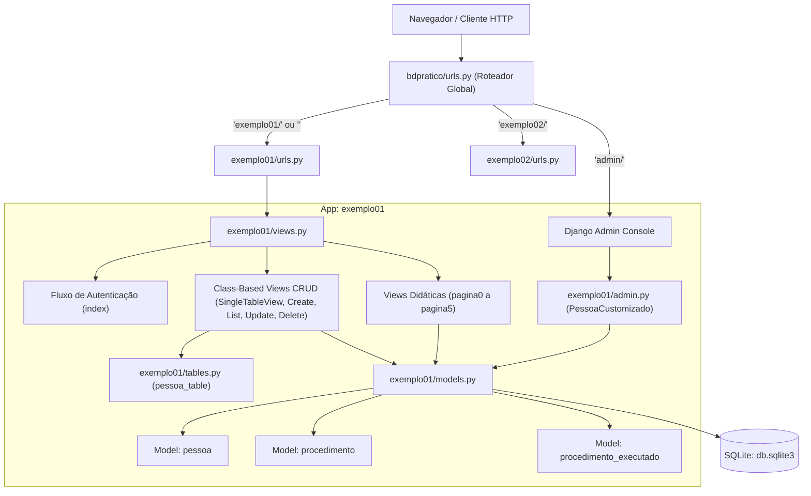

# SPECs - 00: Visão Geral da Arquitetura do Sistema (`bdpratico`)

## 1. Diagnóstico do Arquiteto & Análise de Riscos Imediatos (Ataque à Jugular)

Antes de detalhar a operação, como Arquiteto de Software, é imperativo apontar os pontos críticos e fragilidades estruturais encontradas na base de código atual:

1. **Vulnerabilidade Crítica de Segurança na Sessão (`views.py`):**
   ```python
   # Exemplo encontrado em exemplo01/views.py:L28
   request.session['password'] = senha
   ```
   *Risco:* A senha do usuário está sendo persistida em texto puro na sessão do Django. O Django já armazena o hash criptográfico seguro do usuário autenticado no cookie de sessão via `login(request, user)`. Gravar senhas em plain-text em `request.session` é uma falha severa que expõe credenciais caso as sessões sejam inspecionadas no banco ou em cache compartilhado.

2. **Lógica de Negócio Acoplada nas Views:**
   Tanto em `pagina5` quanto nas CBVs e no `admin.py`, as mutações de banco de dados (`create`, `update`, `save`) ocorrem direto na camada de apresentação. A longo prazo, a ausência de uma camada de `services.py` e `selectors.py` gerará duplicação de regras de negócio e risco de consultas *N+1*.

3. **Inconsistência de Nomenclatura no Roteamento (`reverse_lazy`):**
   As CBVs de `exemplo01` apontam seu redirecionamento para `'pessoa_menu_alias'`, enquanto em `urls.py` a rota do menu está batizada como `'menu_alias'`. Isso causará erro de `NoReverseMatch` em tempo de execução ao salvar ou deletar uma pessoa se não for harmonizado.

---

## 2. Mapa Arquitetural do Projeto

O projeto é estruturado sobre o Django framework, utilizando SQLite como banco relacional local, com bibliotecas externas para aceleração de interface (`bootstrap5` e `django_tables2`).



---

## 3. Estrutura de Diretórios e Escopo dos Módulos

```text
bdpratico/
├── bdpratico/              # Núcleo de configuração do projeto
│   ├── settings.py         # Configurações globais (INSTALLED_APPS, TEMPLATES, DATABASES)
│   ├── urls.py             # Roteador mestre de URLs
│   ├── wsgi.py / asgi.py   # Entrypoints de servidor de aplicação
├── exemplo01/              # Aplicação principal (CRUD completo, relatórios e admin)
│   ├── models.py           # Definições relacionais (pessoa, procedimento, procedimento_executado)
│   ├── views.py            # FBVs didáticas e CBVs especializadas
│   ├── urls.py             # Roteamento interno do app exemplo01
│   ├── admin.py            # Customizações do painel administrativo e ações em lote
│   ├── tables.py           # Configuração de tabelas renderizadas com django_tables2
│   └── templates/          # Templates HTML integrados com Bootstrap 5
├── exemplo02/              # Aplicação secundária (mínima/didática)
│   ├── urls.py & views.py  # View simples de confirmação de roteamento
└── SPECs/                  # Documentação técnica e arquitetural por módulo
```

---

## 4. Índice das Especificações Técnicas

Para aprofundar em cada componente específico, consulte os documentos dedicados nesta pasta:

- **Modelos de Dados:**
  - [SPECs/models/01_model_pessoa.md](file:///Users/rodrigomodel/agentes_inteligentes/SPECs/models/01_model_pessoa.md): Entidade central de cadastro de pessoas e controle de status.
  - [SPECs/models/02_model_procedimento.md](file:///Users/rodrigomodel/agentes_inteligentes/SPECs/models/02_model_procedimento.md): Catálogo de procedimentos médicos/clínicos e codificação CID.
  - [SPECs/models/03_model_procedimento_executado.md](file:///Users/rodrigomodel/agentes_inteligentes/SPECs/models/03_model_procedimento_executado.md): Tabela associativa de relacionamento N:N com métricas de execução.
- **Módulos Operacionais:**
  - [SPECs/modules/04_modulo_views_exemplo01.md](file:///Users/rodrigomodel/agentes_inteligentes/SPECs/modules/04_modulo_views_exemplo01.md): Funcionamento detalhado de cada função e Class-Based View.
  - [SPECs/modules/05_modulo_urls_roteamento.md](file:///Users/rodrigomodel/agentes_inteligentes/SPECs/modules/05_modulo_urls_roteamento.md): Arquitetura de rotas, nomes, parâmetros e include patterns.
  - [SPECs/modules/06_modulo_admin.md](file:///Users/rodrigomodel/agentes_inteligentes/SPECs/modules/06_modulo_admin.md): Ações customizadas, método `@admin.display` de idade e filtros do Admin.
  - [SPECs/modules/07_modulo_tables_frontend.md](file:///Users/rodrigomodel/agentes_inteligentes/SPECs/modules/07_modulo_tables_frontend.md): Configuração do `django_tables2`, colunas de ação e renderização de tabelas.

