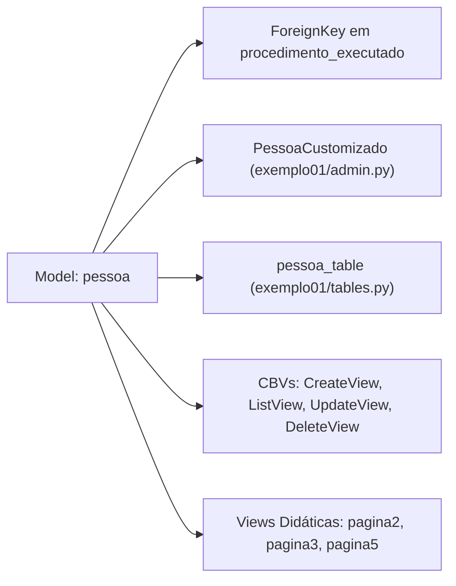

# SPECs - Models: 01. Modelo `pessoa`

## 1. Visão Geral e Responsabilidade

O modelo `pessoa` é a entidade nuclear do app `exemplo01`. Representa o cadastro de indivíduos no sistema (clientes, pacientes ou funcionários), controlando dados de contato, função exercida, data de nascimento e se o registro está ativo para operações de negócio.

---

## 2. Código-Fonte da Implementação

Arquivo: [bdpratico/exemplo01/models.py](file:///Users/rodrigomodel/agentes_inteligentes/bdpratico/exemplo01/models.py#L3-L13)

```python
from django.db import models

class pessoa(models.Model):
    nome = models.CharField(max_length=50, null=False, blank=False, verbose_name='Nome')
    email = models.CharField(max_length=50, null=False, blank=False, verbose_name='eMail')
    celular = models.CharField(max_length=20, null=True, blank=True, verbose_name='celular')
    funcao = models.CharField(max_length=30, null=True, blank=True, verbose_name='Funcao')
    nascimento = models.DateField(null=True, blank=True, verbose_name='Nascimento')
    ativo = models.BooleanField(default=True, verbose_name='Ativo')
    
    def __str__(self):
        return self.nome
        
    class Meta:
        ordering = ['nome', 'funcao',]
```

---

## 3. Detalhamento Campo a Campo

| Campo | Tipo Django | Restrições de Banco / Formulário | Descrição e Papel de Negócio |
| :--- | :--- | :--- | :--- |
| `nome` | `CharField(50)` | `null=False, blank=False` | Nome da pessoa. Obrigatório no banco e nos forms. |
| `email` | `CharField(50)` | `null=False, blank=False` | Endereço de correio eletrônico. Obrigatório. |
| `celular` | `CharField(20)` | `null=True, blank=True` | Telefone de contato com ddd e máscara. Opcional. |
| `funcao` | `CharField(30)` | `null=True, blank=True` | Cargo ou papel profissional exercido. Opcional. |
| `nascimento` | `DateField` | `null=True, blank=True` | Data de nascimento. Utilizada para cálculo de idade. Opcional. |
| `ativo` | `BooleanField` | `default=True` | Flag de soft-delete ou controle de habilitação lógica do cadastro. |

---

## 4. Métodos e Configurações de Meta

### 4.1. Representação Textual (`__str__`)
```python
def __str__(self):
    return self.nome
```
* **O que faz:** Define como a instância do modelo é exibida quando convertida para string — seja no Django Admin, em campos de chave estrangeira (`<select>` HTML) ou em logs de debug.
* **Retorno:** Retorna o próprio `self.nome`.

### 4.2. Ordenação Padrão (`Meta.ordering`)
```python
class Meta:
    ordering = ['nome', 'funcao',]
```
* **O que faz:** Toda consulta ao banco sem um `order_by()` explícito (ex.: `pessoa.objects.all()`) executará automaticamente um `ORDER BY nome ASC, funcao ASC` no banco de dados.

---

## 5. Relações e Onde Este Modelo é Utilizado



1. **Django Admin (`admin.py`):** Configurado na classe `PessoaCustomizado`, com filtros por `funcao` e `ativo`, além do cálculo dinâmico de idade.
2. **Tabela do Frontend (`tables.py`):** A classe `pessoa_table` lê este modelo para exibir a listagem com paginação e links de edição/exclusão.
3. **Chave Estrangeira em `procedimento_executado`:** Cada procedimento executado aponta para um registro de `pessoa` via relacionamento `ForeignKey(..., on_delete=models.CASCADE)`.

---

## 6. Parecer Crítico do Arquiteto & Oportunidades de Refatoração

1. **Convenção PEP 8 de Nomenclatura:**
   - *Atual:* `class pessoa(models.Model)`
   - *Recomendação:* Usar **PascalCase** (`class Pessoa(models.Model)`), alinhando ao padrão canônico do ecossistema Python e Django.
2. **Validação de Email:**
   - *Atual:* `models.CharField(max_length=50)`
   - *Recomendação:* Usar `models.EmailField(max_length=254)`. O `CharField` não valida formato `@` e aceita strings inválidas como `"teste"`.
3. **Soft Delete vs. Hard Delete:**
   - O campo `ativo = models.BooleanField(default=True)` já existe, mas a view `pessoa_delete` realiza um `DeleteView` (exclusão física definitiva do registro no banco via `DELETE FROM`). A arquitetura ideal deve transformar a exclusão em inativação lógica (`ativo=False`).

