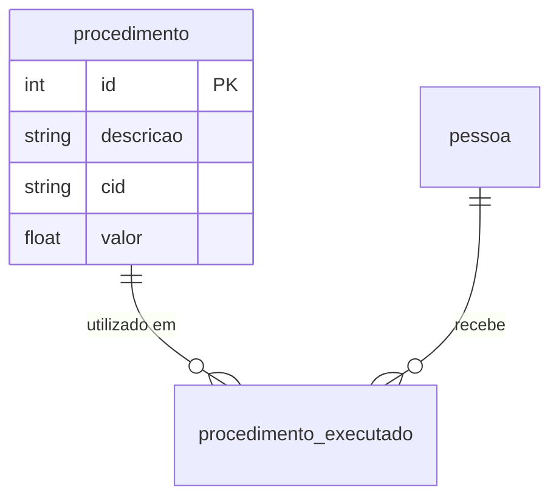

# SPECs - Models: 02. Modelo `procedimento`

## 1. Visão Geral e Responsabilidade

O modelo `procedimento` atua como uma tabela de catálogo / domínio de procedimentos clínicos, ambulatoriais ou cirúrgicos. Ele padroniza as descrições dos serviços oferecidos, seu código de Classificação Internacional de Doenças (CID) associado e o valor de tabela de referência.

---

## 2. Código-Fonte da Implementação

Arquivo: [bdpratico/exemplo01/models.py](file:///Users/rodrigomodel/agentes_inteligentes/bdpratico/exemplo01/models.py#L15-L22)

```python
from django.db import models

class procedimento(models.Model):
    descricao = models.CharField(max_length=50, null=False, blank=False, verbose_name='Descricao')
    cid = models.CharField(max_length=20, null=False, blank=False, verbose_name='CID')
    valor = models.FloatField(null=True, blank=True, default=None, verbose_name='Valor')
    
    def __str__(self):
        return self.descricao
        
    class Meta:
        ordering = ['descricao']
```

---

## 3. Detalhamento Campo a Campo

| Campo | Tipo Django | Restrições | Papel de Negócio & Semântica |
| :--- | :--- | :--- | :--- |
| `descricao` | `CharField(50)` | `null=False, blank=False` | Nome legível do procedimento (ex: *"Consulta Pediátrica"*, *"Eletrocardiograma"*). |
| `cid` | `CharField(20)` | `null=False, blank=False` | Código do CID (ex: *"J00"*, *"I10"*). Obrigatório para categorização médica. |
| `valor` | `FloatField` | `null=True, blank=True, default=None` | Custo monetário padrão do procedimento. Aceita valores nulos. |

---

## 4. Métodos e Configurações de Meta

### 4.1. Representação Textual (`__str__`)
```python
def __str__(self):
    return self.descricao
```
* **O que faz:** Exibe a descrição do procedimento nas listagens e em formulários onde o procedimento for selecionado como chave estrangeira.

### 4.2. Ordenação Padrão (`Meta.ordering`)
```python
class Meta:
    ordering = ['descricao']
```
* **O que faz:** Assegura que todas as consultas ao catálogo retornem ordenadas alfabeticamente pela descrição (`ORDER BY descricao ASC`).

---

## 5. Relações e Integridade Referencial



- Este modelo é o lado `1` da relação `1:N` com `procedimento_executado`.
- Cada registro deste catálogo pode ser referenciado múltiplas vezes em procedimentos já realizados para diferentes pessoas.

---

## 6. Parecer Crítico do Arquiteto & Oportunidades de Refatoração

1. **Risco Financeiro de Arredondamento com `FloatField`:**
   - *Problema:* `FloatField` em Python/Bancos de Dados utiliza representação em ponto flutuante binário (IEEE 754), o que acarreta erros clássicos de precisão aritmética em cálculos monetários (ex: `0.1 + 0.2 = 0.30000000000000004`).
   - *Recomendação do Arquiteto:* Substituir imediatamente por `models.DecimalField(max_digits=10, decimal_places=2)`.
2. **Unicidade de Código (`cid` ou código de procedimento):**
   - Não há restrição de `unique=True` no campo `cid` ou na combinação de `(descricao, cid)`. Isso permite duplicações acidentais no cadastro de catálogo.
3. **Nomenclatura PEP 8:**
   - Adotar `Procedimento` em vez de `procedimento`.

