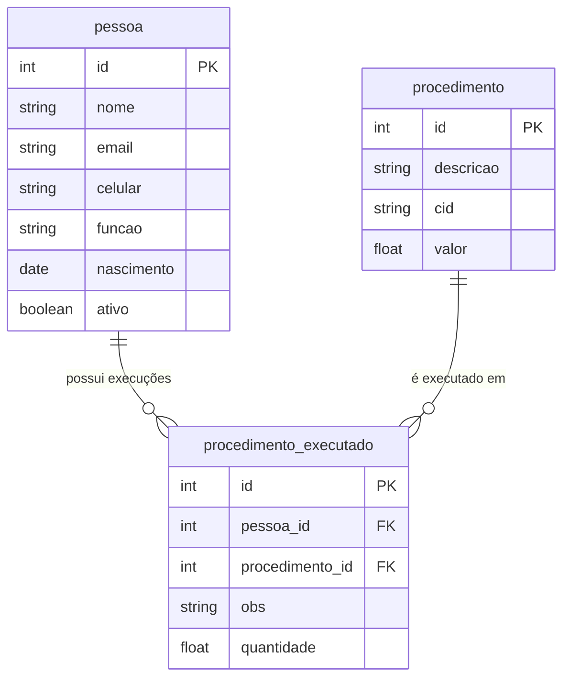

# SPECs - Models: 03. Modelo `procedimento_executado`

## 1. Visão Geral e Responsabilidade

O modelo `procedimento_executado` é a entidade de transação e associação (tabela associativa / N:N com dados adicionais). Ele registra a ocorrência real de um `procedimento` realizado para uma determinada `pessoa`, armazenando a quantidade executada e observações pertinentes ao atendimento.

---

## 2. Código-Fonte da Implementação

Arquivo: [bdpratico/exemplo01/models.py](file:///Users/rodrigomodel/agentes_inteligentes/bdpratico/exemplo01/models.py#L24-L32)

```python
from django.db import models
from .models import pessoa, procedimento

class procedimento_executado(models.Model):
    pessoa = models.ForeignKey(pessoa, on_delete=models.CASCADE)
    procedimento = models.ForeignKey(procedimento, on_delete=models.CASCADE)
    obs = models.CharField(max_length=50, null=False, blank=False, verbose_name='Obs')
    quantidade = models.FloatField(null=True, blank=True, default=None, verbose_name='Quantidade')
    
    def __str__(self):
        return self.obs
        
    class Meta:
        ordering = ['pessoa', 'procedimento']
```

---

## 3. Detalhamento Campo a Campo e Chaves Estrangeiras

| Campo | Tipo Django | Comportamento de Integridade | Papel de Negócio & Semântica |
| :--- | :--- | :--- | :--- |
| `pessoa` | `ForeignKey(pessoa)` | `on_delete=models.CASCADE` | Chave estrangeira para o paciente/pessoa que recebeu o procedimento. Se a pessoa for excluída, todos os seus procedimentos executados serão deletados em cascata. |
| `procedimento` | `ForeignKey(procedimento)` | `on_delete=models.CASCADE` | Chave estrangeira para o procedimento executado. Se o procedimento de catálogo for excluído, os registros de execução associados serão deletados em cascata. |
| `obs` | `CharField(50)` | `null=False, blank=False` | Anotações breves ou justificativas clínicas. Campo obrigatório. |
| `quantidade` | `FloatField` | `null=True, blank=True, default=None` | Volume ou número de vezes que o procedimento foi realizado no mesmo ato. |

---

## 4. Métodos e Configurações de Meta

### 4.1. Representação Textual (`__str__`)
```python
def __str__(self):
    return self.obs
```
* **O que faz:** Retorna o conteúdo da observação (`self.obs`) como identificador em telas do Django Admin e dropdowns.

### 4.2. Ordenação Padrão (`Meta.ordering`)
```python
class Meta:
    ordering = ['pessoa', 'procedimento']
```
* **O que faz:** Assegura a ordenação agrupada primeiro pela chave estrangeira `pessoa_id` e secundariamente por `procedimento_id`.

---

## 5. Diagrama Relacional Entidade-Relacionamento



---

## 6. Parecer Crítico do Arquiteto & Oportunidades de Refatoração

1. **Risco Crítico de `CASCADE` em Registros Históricos:**
   - *Vulnerabilidade:* Se um operador do sistema apagar acidentalmente um registro na tabela de catálogo `procedimento` ou uma `pessoa`, **todo o histórico médico/financeiro de execuções é apagado silenciosamente do banco (`CASCADE`)**.
   - *Recomendação do Arquiteto:* Usar `on_delete=models.PROTECT` ou `on_delete=models.RESTRICT`. Isso impede que procedimentos de catálogo ou pessoas com atendimentos históricos sejam destruídos acidentalmente sem antes tratar o histórico.
2. **Representação Textual Pouco Informativa:**
   - Retornar apenas `self.obs` em `__str__` torna listagens incompreensíveis quando observações são genéricas (ex: *"Ok"*, *"Realizado"*).
   - *Recomendação:*
     ```python
     def __str__(self) -> str:
         return f"{self.pessoa.nome} - {self.procedimento.descricao} ({self.obs})"
     ```
3. **Falta de Timestamp / Data de Execução:**
   - O modelo não possui nenhum campo de data (`data_execucao = models.DateTimeField(auto_now_add=True)`). Em qualquer sistema de auditoria ou contabilidade clínica, saber *quando* o procedimento foi executado é um requisito inegociável.
4. **Campo `quantidade` como `FloatField`:**
   - Se procedimentos são executados em doses unitárias ou contáveis, um `IntegerField` ou `PositiveSmallIntegerField` com `default=1` costuma ser mais rigoroso e seguro contra entradas incorretas como quantidades negativas.

