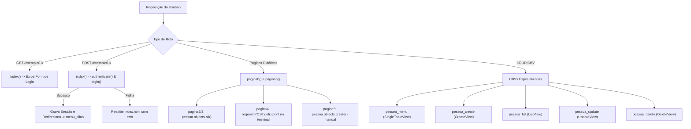

# SPECs - Módulos: 04. Camada de Views (`exemplo01/views.py`)

## 1. Visão Geral e Arquitetura da Camada

O arquivo [bdpratico/exemplo01/views.py](file:///Users/rodrigomodel/agentes_inteligentes/bdpratico/exemplo01/views.py) apresenta uma estrutura didática progressiva, combinando dois paradigmas do Django:
1. **Function-Based Views (FBVs):** Utilizadas nas páginas `pagina0` a `pagina5` para demonstrar passo a passo como o protocolo HTTP opera (renderização simples, injeção de dados de contexto de banco, captura de requisições POST e persistência manual).
2. **Class-Based Views (CBVs):** Utilizadas para o fluxo CRUD produtivo (`CreateView`, `ListView`, `UpdateView`, `DeleteView` e `SingleTableView` via `django_tables2`).

---

## 2. Mapa do Ciclo de Vida das Requisições



---

## 3. Detalhamento Passo a Passo de Cada View

### 3.1. Autenticação e Entrada no Sistema: `index(request)`
```python
def index(request):
    usuario = request.POST.get('username')
    senha = request.POST.get('password')
    user = authenticate(username=usuario, password=senha)
    if (user is not None):
        login(request, user)
        request.session['username'] = usuario
        request.session['password'] = senha
        request.session['usernamefull'] = user.get_full_name()
        from django.shortcuts import redirect
        return redirect('menu_alias')
    else:
        return render(request, 'index.html')
```
* **O que faz:**
  1. Em requisições `POST`, extrai as credenciais enviadas pelo formulário (`username` e `password`).
  2. Executa `authenticate()` consultando o backend de autenticação do Django.
  3. Se as credenciais forem válidas:
     - Invoca `login(request, user)` para inicializar a sessão autenticada.
     - Armazena dados do usuário nas variáveis da sessão HTTP.
     - Redireciona o usuário para o menu principal (`menu_alias`).
  4. Em requisições `GET` ou caso a autenticação falhe, renderiza o template `index.html`.
* **Alerta do Arquiteto:** Armazenar `request.session['password'] = senha` expõe a credencial em texto puro. Deve ser removido.

---

### 3.2. Trilhas Didáticas: `pagina0` a `pagina5`

#### `pagina0(request)` e `pagina1(request)`: Renderização Estática
```python
def pagina0(request):
    return render(request, 'pagina0.html')

def pagina1(request):
    return render(request, 'pagina1.html')
```
* **O que faz:** Introdução à renderização de templates HTML simples e integração com arquivos estáticos (``).

#### `pagina2(request)` e `pagina3(request)`: Injeção de Contexto ORM
```python
def pagina2(request):
    dicionario = {}
    registros = pessoa.objects.all()
    dicionario['pessoas'] = registros
    return render(request, 'pagina2.html', dicionario)
```
* **O que faz:**
  1. Faz a leitura completa da tabela `pessoa` no banco via ORM (`pessoa.objects.all()`).
  2. Encapsula o `QuerySet` em uma chave `'pessoas'` dentro de um dicionário Python.
  3. Envia para o template como contexto, permitindo a iteração via tag `` em tabelas Bootstrap.

#### `pagina4(request)`: Interceptação de Dados POST
```python
def pagina4(request):
    nome = request.POST.get('nome')
    email = request.POST.get('email')
    # ... outros campos ...
    print("Nome:", nome)
    return render(request, 'pagina4.html')
```
* **O que faz:** Captura cada parâmetro enviado no corpo da requisição HTTP POST e imprime no console para depuração e inspeção do payload HTTP.

#### `pagina5(request)`: Persistência Manual no Banco de Dados
```python
def pagina5(request):
    xnome = request.POST.get('nome')
    # ...
    if (xnome is not None):
        xativo = False
        if (xativo == 'on'):
            xativo = True
            pessoa.objects.create(nome=xnome, email=xemail, celular=xcelular,
            funcao=xfuncao, nascimento=xnascimento, ativo=xativo)
    return render(request, 'pagina5.html')
```
* **O que faz:** Exemplifica a criação programática de registros no banco sem o uso de `ModelForm`.
* **Atenção:** Há um bug lógico na condição `if (xativo == 'on'):` logo após `xativo = False`, impedindo a inserção. Em produção, este tipo de fluxo deve ser substituído por `Django Forms` ou `CreateView`.

---

### 3.3. CRUD Produtivo via Class-Based Views (CBVs)

#### `pessoa_menu` (SingleTableView)
```python
class pessoa_menu(SingleTableView):
    model = pessoa
    table_class = pessoa_table
    template_name_suffix = '_menu'
    table_pagination = {"per_page": 5}
    template_name = 'exemplo01/pessoa_menu.html'
```
* **O que faz:** View de dashboard que combina o poder do `django_tables2`. Realiza consulta paginada (5 registros por página) e injeta a tabela estilizada diretamente no template.

#### `pessoa_create` (CreateView)
```python
class pessoa_create(CreateView):
    model = pessoa
    fields = ['nome', 'email', 'celular', 'funcao', 'nascimento', 'ativo']
    success_url = reverse_lazy('pessoa_menu_alias')
```
* **O que faz:** Gera automaticamente o formulário HTML (`pessoa_form.html`), valida os campos tipados e, ao submeter com sucesso, salva o registro e redireciona.

#### `pessoa_list` (ListView)
```python
class pessoa_list(ListView):
    model = pessoa
    queryset = pessoa.objects.filter(ativo=True)
```
* **O que faz:** Fornece listagem simplificada via template `pessoa_list.html`, filtrando estritamente registros habilitados (`ativo=True`).

#### `pessoa_update` (UpdateView)
```python
class pessoa_update(UpdateView):
    model = pessoa
    fields = ['nome', 'email', 'celular', 'funcao', 'nascimento', 'ativo']
    success_url = reverse_lazy('pessoa_menu_alias')
```
* **O que faz:** Recupera a instância existente pelo identificador primário passado na URL (`<int:pk>`), preenche o formulário para edição e persiste as modificações no banco de dados.

#### `pessoa_delete` (DeleteView)
```python
class pessoa_delete(DeleteView):
    model = pessoa
    fields = ['nome', 'email', 'celular', 'funcao', 'nascimento', 'ativo']
    template_name_suffix = '_delete'
    success_url = reverse_lazy('pessoa_menu_alias')
```
* **O que faz:** Busca a pessoa pelo `pk`, renderiza a tela de confirmação de exclusão (`pessoa_delete.html`) e, após submissão via POST, executa a remoção do registro.

