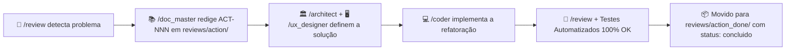

# Central de Relatórios de Auditoria e Reviews

Este diretório armazena o histórico cronológico de todas as auditorias de código realizadas pelo **Agente 1 (Tech Lead Reviewer)** (`/review`), administrado com rigor pelo **Guardião da Documentação & Specs** (`/doc_master`).

---

## 🗂️ Estrutura de Diretórios & Governança de Ações

Cada problema apontado em uma auditoria **DEVE** estar vinculado obrigatoriamente a uma proposta formal de solução dentro da pasta `action/`. Assim que a solução é implementada e validada com testes pelo `/coder`, o arquivo é promovido e arquivado em `action_done/`:

```text
projeto_testes/reviews/
├── README.md                                          # Índice central e governança de auditorias
├── action/                                            # Propostas de ação pendentes (backlog ativo - vazio)
├── action_done/                                       # Ações implementadas e arquivadas com sucesso
│   ├── ACT-001_expurgo_vetores_e_arquivos_ao_deletar_sessao.md
│   ├── ACT-002_ingestao_documentos_rag_rollback_e_feedback_ux.md
│   ├── ACT-003_servico_delecao_personas_e_sessao_fallback.md
│   ├── ACT-004_mitigacao_starvation_streaming_wsgi_asgi.md
│   ├── ACT-005_expurgo_mutacao_seletor_persona_padrao.md
│   ├── ACT-006_otimizacao_painel_reaproveitamento_sessoes.md
│   ├── ACT-007_indices_banco_dados_alta_frequencia.md
│   ├── ACT-008_padronizacao_decorators_http_views.md
│   ├── ACT-009_embedding_assincrono_pos_streaming.md
│   ├── ACT-010_correcao_fuso_horario_timezone_localdate.md
│   ├── ACT-011_otimizacao_query_agregada_balanco_e_ai_tools.md
│   └── ACT-012_correcoes_ux_redirect_competencia_e_hotkeys.md
├── app_chatbot/                                       # Relatórios cronológicos por módulo
│   ├── 0001_review_servicos_rag_e_personas.md         # Status: RESOLVIDO
│   ├── 0002_review_completo_arquitetura_e_fluxos.md   # Status: RESOLVIDO
│   └── 0003_review_otimizacoes_e_cqrs.md              # Status: RESOLVIDO
└── app_financas/                                      # Relatórios cronológicos de finanças
    └── 0001_review_financas.md                        # Status: RESOLVIDO
```

---

## 📋 Catálogo Geral de Auditorias

| ID Review | Módulo | Data | Auditor | Status | Ações Concluídas e Arquivadas |
| :--- | :--- | :--- | :--- | :--- | :--- |
| **REV-0001** | `app_chatbot` | 2026-11-02 | Tech Lead Reviewer | `RESOLVIDO` | Hardening de RAG batching, validação 2MB e prefixo de slug. |
| [**REV-0002**](file:///Users/rodrigomodel/agentes_inteligentes/projeto_testes/reviews/app_chatbot/0002_review_completo_arquitetura_e_fluxos.md) | `app_chatbot` | 2026-11-02 | Tech Lead Reviewer | `RESOLVIDO` | [ACT-001](file:///Users/rodrigomodel/agentes_inteligentes/projeto_testes/reviews/action_done/ACT-001_expurgo_vetores_e_arquivos_ao_deletar_sessao.md), [ACT-002](file:///Users/rodrigomodel/agentes_inteligentes/projeto_testes/reviews/action_done/ACT-002_ingestao_documentos_rag_rollback_e_feedback_ux.md), [ACT-003](file:///Users/rodrigomodel/agentes_inteligentes/projeto_testes/reviews/action_done/ACT-003_servico_delecao_personas_e_sessao_fallback.md), [ACT-004](file:///Users/rodrigomodel/agentes_inteligentes/projeto_testes/reviews/action_done/ACT-004_mitigacao_starvation_streaming_wsgi_asgi.md) |
| [**REV-0003**](file:///Users/rodrigomodel/agentes_inteligentes/projeto_testes/reviews/app_chatbot/0003_review_otimizacoes_e_cqrs.md) | `app_chatbot` | 2026-11-02 | Tech Lead Reviewer | `RESOLVIDO` | [ACT-005](file:///Users/rodrigomodel/agentes_inteligentes/projeto_testes/reviews/action_done/ACT-005_expurgo_mutacao_seletor_persona_padrao.md), [ACT-006](file:///Users/rodrigomodel/agentes_inteligentes/projeto_testes/reviews/action_done/ACT-006_otimizacao_painel_reaproveitamento_sessoes.md), [ACT-007](file:///Users/rodrigomodel/agentes_inteligentes/projeto_testes/reviews/action_done/ACT-007_indices_banco_dados_alta_frequencia.md), [ACT-008](file:///Users/rodrigomodel/agentes_inteligentes/projeto_testes/reviews/action_done/ACT-008_padronizacao_decorators_http_views.md), [ACT-009](file:///Users/rodrigomodel/agentes_inteligentes/projeto_testes/reviews/action_done/ACT-009_embedding_assincrono_pos_streaming.md) |
| [**REV-0004**](file:///Users/rodrigomodel/agentes_inteligentes/projeto_testes/reviews/app_financas/0001_review_financas.md) | `app_financas` | 2026-11-04 | Tech Lead Reviewer | `RESOLVIDO` | [ACT-010](file:///Users/rodrigomodel/agentes_inteligentes/projeto_testes/reviews/action_done/ACT-010_correcao_fuso_horario_timezone_localdate.md), [ACT-011](file:///Users/rodrigomodel/agentes_inteligentes/projeto_testes/reviews/action_done/ACT-011_otimizacao_query_agregada_balanco_e_ai_tools.md), [ACT-012](file:///Users/rodrigomodel/agentes_inteligentes/projeto_testes/reviews/action_done/ACT-012_correcoes_ux_redirect_competencia_e_hotkeys.md) |

---

## 🧭 Ciclo de Vida da Ação (Workflow)


