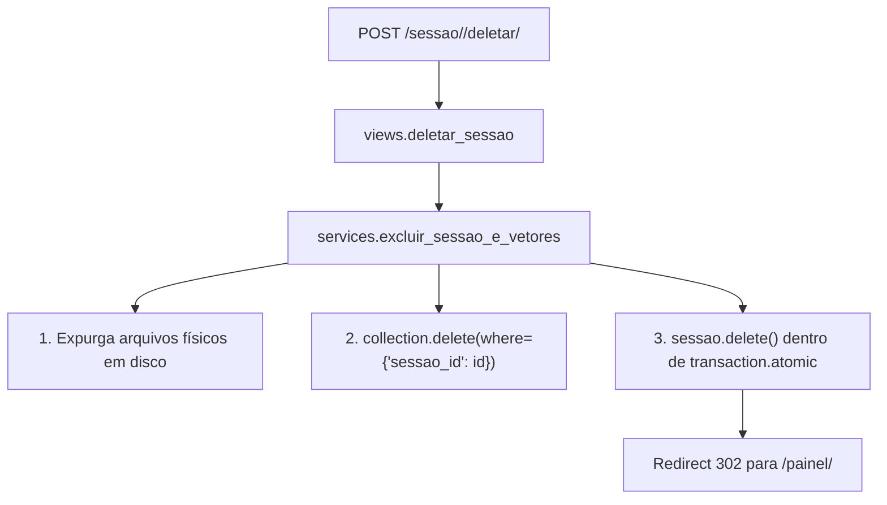

# Proposta de Ação ACT-001: Expurgo de Vetores e Arquivos na Exclusão de Sessão

## 1. Problema Identificado no Review
Na view `deletar_sessao` ([views.py](file:///Users/rodrigomodel/agentes_inteligentes/projeto_testes/app_chatbot/views.py#L254-L259)), a exclusão é feita chamando diretamente `sessao.delete()`. Embora o SQLite remova as mensagens e os documentos em cascata (`CASCADE`), **o ChromaDB não recebe nenhuma notificação**, deixando centenas de vetores órfãos (`tipo: memoria_conversa` e `tipo: documento_rag`) consumindo memória e disco para sempre. Além disso, arquivos físicos em `media/docs_chat/` não são expurgados do disco.

---

## 2. Parecer do Arquiteto de Software (/architect)

> **Diagnóstico Arquitetural:**
> O SQLite e o ChromaDB formam um armazenamento poliglota desprovido de transação distribuída nativa (não há Two-Phase Commit). Se a aplicação delegar a integridade apenas ao `CASCADE` relacional do Django, o banco vetorial e o storage de arquivos viram depósitos de lixo fantasma (Memory Leaks em disco).
>
> **Trade-offs de Padrão:**
> 1. *Django Post-Delete Signals:* Parecem mágicos, mas escondem efeitos colaterais em testes, quebram transações atômicas e falham silenciosamente.
> 2. *Service Layer Explícita (Recomendado):* Criar `excluir_sessao_e_vetores(*, sessao: SessaoChat)` em `services.py`. O serviço realiza:
>    - Coleta de IDs de documentos vinculados à sessão.
>    - Exclusão atômica de arquivos físicos em disco.
>    - Chamada ao ChromaDB: `collection.delete(where={"sessao_id": str(sessao.id)})`.
>    - Exclusão do registro `sessao.delete()` dentro de `transaction.atomic()`.



---

## 3. Especificação Técnica da Solução

### Assinatura do Serviço em `services.py`:
```python
@transaction.atomic
def excluir_sessao_e_vetores(*, sessao: SessaoChat, usuario: User) -> None:
    """Exclui a sessão, expurga arquivos físicos e limpa todos os vetores do ChromaDB.

    Args:
        sessao: Instância da sessão a ser destruída.
        usuario: Usuário solicitante (trava de segurança IDOR).

    Raises:
        SessaoNaoEncontradaError: Se a sessão não pertencer ao usuário.
    """
```

### Checklist de Implementação para o /coder:
- [x] Criar função `excluir_sessao_e_vetores` em `services.py` com limpeza de disco e ChromaDB.
- [x] Refatorar a view `deletar_sessao` em `views.py` para invocar o serviço em vez de `sessao.delete()`.
- [x] Adicionar testes unitários em `tests.py` validando que a exclusão da sessão remove documentos do disco e chama o expurgo vetorial.

