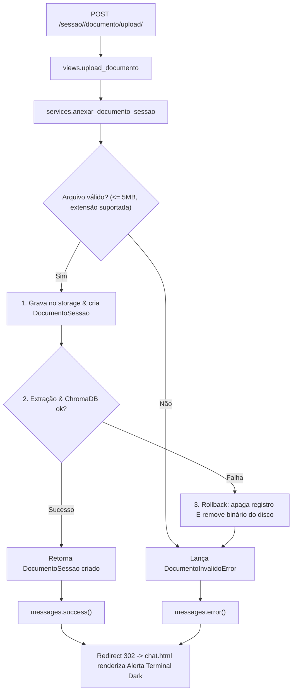

# Proposta de Ação ACT-002: Ingestão Defensiva de Documentos RAG com Rollback de Storage e Feedback Visual

## 1. Problema Identificado no Review (Ponta a Ponta)

A funcionalidade de upload e indexação de documentos para RAG ([views.py](file:///Users/rodrigomodel/agentes_inteligentes/projeto_testes/app_chatbot/views.py#L195-L233) e [chat.html](file:///Users/rodrigomodel/agentes_inteligentes/projeto_testes/app_chatbot/templates/app_chatbot/chat.html)) apresentava duas falhas complementares do mesmo fluxo:

1. **Falha de Backend (Storage & Camadas):**
   - A view `upload_documento` criava instâncias no ORM diretamente (`DocumentoSessao.objects.create`), salvando o arquivo binário em disco antes da validação.
   - Em caso de falha de extração ou indexação (`DocumentoInvalidoError`), chamava `doc.delete()`. O método padrão de deleção do Django **não apaga o arquivo físico gravado no disco** (`media/docs_chat/YYYY/MM/...`), acumulando centenas de binários corrompidos como lixo órfão no servidor.
   - A view acessava `os.getenv` diretamente, quebrando o isolamento da camada de serviços (*Thin Views / Fat Services*).

2. **Falha de Frontend & Usabilidade (UX/UI):**
   - Se o arquivo excedesse 5MB ou se a extração falhasse, a view efetuava um redirecionamento silencioso (`return redirect(url_painel)`) sem disparar nenhuma notificação.
   - O template principal [`chat.html`](file:///Users/rodrigomodel/agentes_inteligentes/projeto_testes/app_chatbot/templates/app_chatbot/chat.html) sequer possuía o bloco de renderização do framework de mensagens do Django (`messages`), deixando o operador em total escuridão sobre o sucesso ou falha da ingestão.

---

## 2. Parecer do Arquiteto de Software (/architect)

> **Decisão Arquitetural:**
> O ciclo de ingestão de documentos deve ser tratado como uma **unidade de trabalho atômica com rollback garantido**:
>
> 1. *Encapsulamento em Serviço:* Criar `anexar_documento_sessao(sessao=..., arquivo=..., max_mb=5)` em `services.py`.
> 2. *Protocolo de Rollback Duplo:* Se qualquer etapa da extração textual ou da vetorização no ChromaDB falhar, o serviço deve:
>    - Apagar o registro no SQLite;
>    - Executar `doc.arquivo.delete(save=False)` para garantir extermínio de binários órfãos no sistema de arquivos;
>    - Propagar exceção tipada de domínio (`DocumentoInvalidoError`) com mensagem amigável para a camada de apresentação.
> 3. *Thin View:* A view apenas captura o arquivo da requisição multipart, invoca o serviço e registra mensagens no framework `django.contrib.messages`.



---

## 3. Parecer do Especialista em UX/UI (/ux_designer)

> **Diagnóstico Heurístico (10 Heurísticas de Nielsen):**
> - *Heurística 1 (Visibilidade do Status do Sistema):* O operador deve receber confirmação explícita de que os chunks do documento foram calculados e inseridos no contexto semântico.
> - *Heurística 5 (Prevenção de Erros):* Exibir claramente na interface os limites de arquivo (`<= 5MB`) e formatos suportados (`.pdf`, `.txt`, `.md`, `.csv`, `.json`, `.py`).
> - *Heurística 9 (Auxiliar no Reconhecimento e Recuperação de Erros):* Mensagens ácidas e claras em caso de rejeição, instruindo como converter ou redimensionar o documento.

### Wireframe ASCII (Painel de Notificações Terminal Dark no `chat.html`):
```text
┌────────────────────────────────────────────────────────────────────────┐
│ [STATUS_INGESTÃO_RAG]                                                  │
├────────────────────────────────────────────────────────────────────────┤
│ 🟢 [SUCESSO] Arquivo 'especificacao.md' indexado com sucesso           │
│              (12 chunks calculados e persistidos no ChromaDB).         │
├────────────────────────────────────────────────────────────────────────┤
│ 🛑 [REJEIÇÃO] O arquivo 'dump_pesado.pdf' excede o limite de 5MB.      │
│               Reduza o arquivo ou envie em formato .txt/.md.           │
│                                                            [DESCARTAR] │
└────────────────────────────────────────────────────────────────────────┘
```

### Tokens e Estilização CSS:
- **Sucesso:** Borda e texto `#00ff66` (Neon Green), fundo `#0a1f0f`, badge `[OK]`.
- **Erro:** Borda e texto `#ff3366` (Neon Red), fundo `#2a0810`, badge `[ERRO]`.
- **Tipografia:** `font-family: 'JetBrains Mono', 'Fira Code', monospace`.

---

## 4. Especificação Técnica da Solução

### Assinatura do Serviço em `services.py`:
```python
def anexar_documento_sessao(
    *,
    sessao: SessaoChat,
    arquivo_upload: Any,
    max_mb: int = 5
) -> DocumentoSessao:
    """Valida, persiste, extrai texto e indexa vetores de documento para RAG com rollback limpo do storage.

    Args:
        sessao: Sessão à qual o documento será anexado.
        arquivo_upload: Instância do UploadedFile.
        max_mb: Tamanho máximo permitido em Megabytes.

    Returns:
        DocumentoSessao: Instância persistida e indexada com total_chunks > 0.

    Raises:
        DocumentoInvalidoError: Se o arquivo violar limites de tamanho, extensão ou falhar na indexação.
    """
```

---

## 5. Checklist Unificado de Implementação para o /coder:

- [x] **Backend:** Implementar `anexar_documento_sessao` em `services.py` com rollback duplo (`doc.arquivo.delete(save=False)` + `doc.delete()`) em caso de exceção.
- [x] **Backend:** Refatorar `upload_documento` em `views.py` para invocar o serviço e registrar `messages.success` e `messages.error`.
- [x] **Frontend:** Incluir bloco de renderização do `django.contrib.messages` em `chat.html` com a estética Terminal Dark e botão de dispensar alerta.
- [x] **Frontend:** Adicionar texto de ajuda no modal/botão de upload com os limites suportados (<= 5MB, extensões válidas).
- [x] **Testes:** Criar testes automatizados em `tests.py` cobrindo:
  - Upload com sucesso e conferência da mensagem de sucesso;
  - Tentativa de upload com arquivo > 5MB e conferência da mensagem de erro;
  - Garantia de que após falha de indexação nenhum arquivo físico órfão reste no disco.

