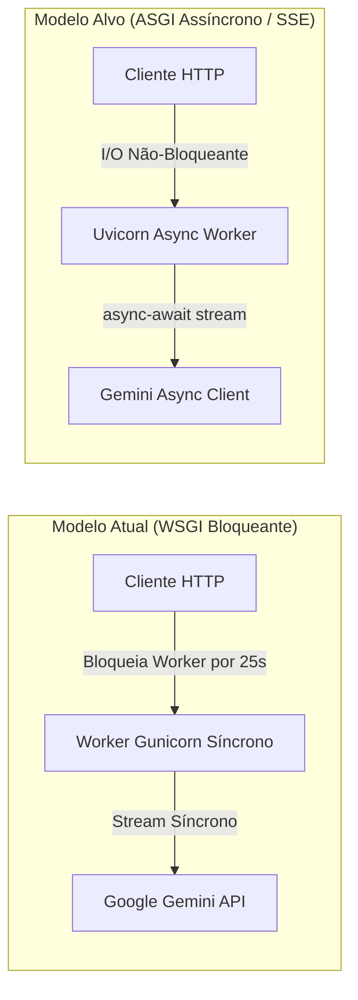

# Proposta de Ação ACT-004: Mitigação de Starvation de Threads WSGI em Streaming de IA

## 1. Problema Identificado no Review
Na view `chat_stream` ([views.py](file:///Users/rodrigomodel/agentes_inteligentes/projeto_testes/app_chatbot/views.py#L278-L306)) e em `services.executar_chat_stream`:
O gerador de streaming do Gemini (`client.models.generate_content_stream(...)`) é entregue diretamente via `StreamingHttpResponse`.

Em um servidor de aplicação WSGI tradicional (ex: Gunicorn síncrono com 4 workers), cada requisição de streaming de IA segura o processo/thread HTTP bloqueado por 10 a 30 segundos (tempo de inferência e transmissão completa dos tokens). Com 4 ou 5 usuários simultâneos, o pool de conexões do servidor se esgota, causando *Worker Starvation* e travando todo o sistema para requisições rápidas de login ou navegação.

---

## 2. Parecer do Arquiteto de Software (/architect)

> **Diagnóstico & Estratégia de Transição:**
> Trata-se do clássico conflito entre I/O bloqueante prolongado de LLMs e a arquitetura síncrona WSGI.
>
> **Plano de Ação em Duas Fases:**
>
> 1. **Fase I (Mitigação Imediata / Defensiva no WSGI):**
>    - Adicionar timeout estrito de inferência e de streaming (`timeout=30s`).
>    - Desacoplar tarefas pesadas pós-chat (como indexação de memória vetorial no ChromaDB) para execução assíncrona ou fire-and-forget.
>    - Configurar cabeçalho `X-Accel-Buffering: no` e `Cache-Control: no-cache` já presentes, com verificação de encerramento da conexão do cliente (`client disconnect detection`).
>
> 2. **Fase II (Evolução de Escala - ASGI / SSE / Channels):**
>    - Migrar o endpoint `/chat/stream/` para uma interface ASGI nativa (ex: Uvicorn / Daphne) ou Server-Sent Events (SSE) assíncrono via `async for chunk in response_stream: yield ...`.
>    - Isolar o pool de conexões de streaming das rotas relacionais CRUD do Django.

---

## 3. Checklist de Implementação para o /coder:
- [x] Adicionar parâmetro de timeout defensivo na configuração do `GenerateContentConfig` em `services.py`.
- [x] Encapsular a indexação de memória vetorial no ChromaDB (`_indexar_memoria`) para não atrasar o retorno final do stream.
- [x] Documentar no `Architeture.md` a necessidade de transição para ASGI para suportar concorrência acima de 20 conexões ativas.

