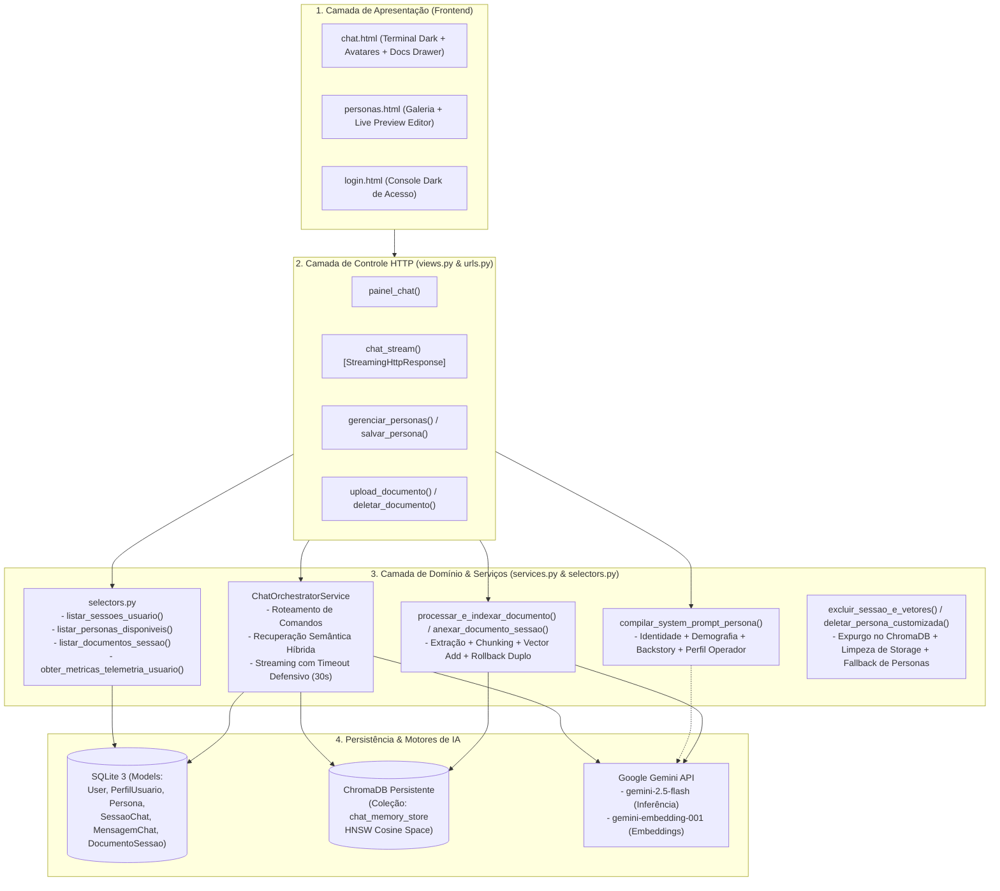

# 🏛️ Architecture.md — Visão Arquitetural Global do Sistema

Este documento descreve a topologia, os padrões de projeto, o fluxo de dados e os princípios de engenharia que governam o ecossistema do Chatbot Inteligente.

---

## 1. Princípios de Engenharia Inegociáveis

1. **Monólito Modular Django (Two Scoops of Django):**
   - O Django atua como o hub central: autenticação, orquestração de banco, rotas HTTP e painel administrativo.
   - Nada de lógica de domínio em views ou models obesos.
2. **Camadas Estritas:**
   - **`services.py`:** Transações, validações de negócio, mutações, compilação de IA e chamadas externas.
   - **`selectors.py`:** Consultas e leituras de banco puras, aniquilando problemas N+1 via `select_related` e `prefetch_related`.
   - **`exceptions.py`:** Erros de domínio tipados em classes (`TituloInvalidoError`, `PersonaInvalidaError`, etc.).
   - **`views.py` (FBVs):** Function-Based Views magras que apenas traduzem requisições HTTP, chamam seletores/serviços e retornam responses.
3. **Memória Híbrida em Dois Níveis:**
   - **Curto Prazo / Ordem Cronológica:** Banco relacional SQLite via `MensagemChat`.
   - **Longo Prazo / Semântica / RAG:** Banco vetorial local ChromaDB via `VectorStoreManager` com embeddings `gemini-embedding-001` (3072 dimensões).
4. **Isolamento Multi-tenant (Prevenção Estrita de IDOR):**
   - Toda consulta de sessão, documento ou persona é obrigatoriamente filtrada por `usuario=request.user` ou `is_sistema=True`.

---

## 2. Diagrama de Arquitetura em Camadas



---

## 3. Fluxo de Vida de uma Mensagem no Chat

1. O operador envia uma pergunta via `fetch POST /chat/stream/` com `csrfmiddlewaretoken` e `sessao_id`.
2. A view valida o IDOR garantindo que a sessão pertence ao `request.user`.
3. O `ChatOrchestratorService` é instanciado para a sessão:
   - Verifica comandos imediatos locais (`/status`, `/docs`, `/persona <slug>`, `/ajuda`).
   - Salva a pergunta do usuário no SQLite (`papel='user'`).
   - Carrega o histórico imediato (últimos 6 turnos válidos).
   - Realiza busca semântica no ChromaDB filtrada por `sessao_id` (resgatando memórias passadas e chunks de documentos anexados).
   - Compila o System Prompt com a `Persona` ativa da sessão e o `PerfilUsuario`.
   - Dispara a chamada com streaming no modelo `gemini-2.5-flash`.
   - Transmite os chunks textuais via `StreamingHttpResponse` para a tela em tempo real com cursor piscante.
4. Ao concluir a resposta:
   - Salva a resposta no SQLite (`papel='model'`) com a telemetria de `tokens_utilizados`.
   - Gera o embedding do par pergunta/resposta e indexa no ChromaDB como memória de longo prazo.
   - Em caso de falha de API, transmite mensagem amigável no stream, mas **nunca grava o stack trace no banco** para não poluir o histórico futuro.

---

## 4. Estrutura de Pastas do Projeto

```text
agentes_inteligentes/
├── .agents/                 # Agentes especialistas, skills e regras operacionais
├── docs/entregas/           # Resumos executivos de entregas formais
├── projeto_testes/          # Projeto Django principal
│   ├── specs/               # Especificações técnicas, manuais e decisões (ADRs)
│   │   ├── modulos_internos/# Subsistemas internos (ChromaDB, RAG, Prompt Assembler)
│   │   ├── modulos_externos/# Funcionalidades voltadas ao usuário (Chat, Personas, Perfil)
│   │   ├── UXUI/            # Wireframes, guia de estilo e telas explicadas
│   │   ├── Ideias/          # Laboratório de novas features, ideias e templates
│   │   │   └── arquivadas/  # Ideias já promovidas para desenvolvimento real
│   │   ├── architeture/     # ADRs e decisões arquiteturais
│   │   ├── archive/         # Módulos descontinuados
│   │   ├── ROADMAP.md       # Roadmap de evolução
│   │   ├── Architecture.md  # Visão arquitetural unificada (este arquivo)
│   │   └── SPECs.md         # Índice mestre
│   ├── reviews/             # Relatórios de auditoria por módulo do /review
│   │   ├── README.md        # Diretrizes e governança de auditorias
│   │   ├── action/          # Propostas de ação ativas e pendentes
│   │   ├── action_done/     # Ações concluídas, validadas e arquivadas
│   │   └── app_chatbot/     # Laudos numerados com checklist de resolução
│   ├── app_chatbot/         # Aplicativo do Chatbot (Core de IA)
│   │   ├── models.py        # Schemas de banco de dados
│   │   ├── selectors.py     # Queries isoladas sem N+1
│   │   ├── services.py      # Lógica de negócio e orquestração de IA
│   │   ├── exceptions.py    # Exceções de domínio tipadas
│   │   ├── views.py         # FBVs magras
│   │   ├── urls.py          # Rotas do app
│   │   ├── tests.py         # Suíte com 45 testes automatizados (100% OK)
│   │   ├── templates/       # Templates HTML Bootstrap Dark Neon
│   │   └── migrations/      # Migrações aplicadas
│   └── media/               # Uploads de documentos, fotos de personas e perfis
└── README.md                # Guia do usuário para interagir com o servidor

---

## 5. Diretrizes de Concorrência & Roadmap ASGI (ACT-004)

1. **Mitigação Defensiva em WSGI:**
   - O streaming de inferência do Gemini opera com timeout estrito de 30 segundos (`types.HttpOptions(timeout=30000)`).
   - A indexação vetorial de memória (`_indexar_memoria`) é desacoplada com bloco try/catch não-bloqueante para não atrasar a finalização do stream HTTP.
2. **Evolução de Escala (Roadmap):**
   - Transição do endpoint `/chat/stream/` para interface assíncrona ASGI nativa (Uvicorn / Daphne) com Server-Sent Events (SSE) quando a concorrência média de usuários ativos superar 20 sessões simultâneas.
```

