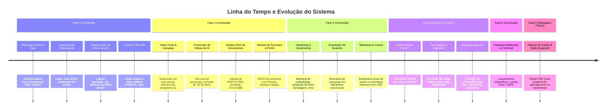

# 🧭 ROADMAP.md — Evolução e Marcos do Projeto

Este documento apresenta a trajetória de desenvolvimento do Chatbot Inteligente, os marcos já concluídos com sucesso e as próximas etapas de evolução arquitetural e funcional.

---

## 🏁 Status dos Marcos (Milestones)

---

## 📌 Detalhamento das Fases

### ✅ Fase 1: Fundação & Interface Terminal (Concluída)
- [x] Criação do aplicativo `app_chatbot` e integração ao Django.
- [x] Redesign visual para o padrão **Terminal/Console Imersivo (Dark Mode com acentos Verde Neon)**.
- [x] Sistema de autenticação integrado com `@login_required` em todas as rotas.
- [x] Isolamento multi-tenant de conversas e travas rígidas contra IDOR.
- [x] Restauração automática da última conversa acessada após o login (`-acessado_em`).
- [x] Edição in-place do título da sessão com validação anti-XSS e limite de 80 caracteres.

### ✅ Fase 2: RAG, Clean Architecture & Personas (Concluída)
- [x] Refatoração arquitetural no padrão *Two Scoops of Django*: criação de `selectors.py` e `exceptions.py`.
- [x] Eliminação da exclusão via `GET` (substituída por `POST` com CSRF).
- [x] Módulo RAG com extração de texto, chunking semântico com overlap de 150 caracteres e indexação vetorial no ChromaDB.
- [x] Gaveta retrátil no chat para anexar e excluir documentos da sessão.
- [x] Sistema completo de Personas com modelos de dados, demografia (idade, sexo, escolaridade), tom de voz, backstory e diretrizes.
- [x] Nova Central de Personas (`/personas/`) com Live Preview split-screen e tela de Perfil do Operador.
- [x] Exibição de avatares duplos nas bolhas de chat (usuário à direita e persona à esquerda).
- [x] Suíte de 32 testes automatizados com 100% de cobertura de sucesso.

### ✅ Fase 3: Hardening, Governança, Exportação & Telemetria (Concluída)
- [x] **Batching no Embedding de Documentos:** Envio de chunks em lote para o Google GenAI, reduzindo I/O de rede.
- [x] **Validação Defensiva de Imagens:** Limite estrito de 2MB e whitelist de formatos (`.png`, `.jpg`, `.jpeg`, `.webp`, `.svg`).
- [x] **Feedback com Django Messages:** Alertas visuais neon no padrão Terminal Dark em caso de sucesso ou erro.
- [x] **Proteção de Slugs Reservados:** Prefixo defensivo automático (`user-`) blindando os presets de sistema.
- [x] **Guardião da Documentação & Orquestrador de Specs (`/doc`, `/specs`):** Governança ativa em `projeto_testes/specs/` e `projeto_testes/reviews/`.
- [x] **Módulo de Exportação:** Download do histórico completo em Markdown estruturado. ➔ Consolidado em [`modulos_externos/exportador_conversas_markdown.md`](./modulos_externos/exportador_conversas_markdown.md)
- [x] **Dashboard de Telemetria:** Painel executivo exibindo consumo agregado de tokens e estimativas de custo financeiro da API em USD. ➔ Consolidado em [`modulos_externos/dashboard_telemetria_tokens_custos.md`](./modulos_externos/dashboard_telemetria_tokens_custos.md)
- [x] Suíte ampliada para 41 testes automatizados com 100% de sucesso.

### 🔮 Fase 4: Inteligência Avançada & Escala (Próximo Ciclo)
- [ ] **Busca Semântica Global (`Cmd+K`):** Varredura transversal em todas as memórias e conversas do operador via ChromaDB. ➔ Associado a [`specs/Ideias/busca_semantica_global_cmdk.md`](./Ideias/busca_semantica_global_cmdk.md)
- [x] **Agentes Multi-Step com Tool Calling:** Capacidade do chatbot de rodar ferramentas tipadas (data/hora oficial, calculadora segura por AST, documentos RAG e telemetria). ➔ Consolidado em [`specs/modulos_internos/agentes_multi_step_tool_calling.md`](./modulos_internos/agentes_multi_step_tool_calling.md) (Ideia arquivada em [`specs/Ideias/arquivadas/agentes_multi_step_tool_calling.md`](./Ideias/arquivadas/agentes_multi_step_tool_calling.md))
- [ ] **Hub Interativo de Ajuda, Ferramentas & Habilidades:** Modal HUD e atalho global para inspecionar e acionar ferramentas ativas, comandos slash e personas em tempo real. ➔ Associado a [`specs/Ideias/hub_capacidades_e_ajuda_interativo.md`](./Ideias/hub_capacidades_e_ajuda_interativo.md)
- [ ] **Migração de ChromaDB para PostgreSQL + `pgvector`:** Unificação da persistência relacional e vetorial no mesmo banco de dados com transações ACID completas. ➔ Associado a [`specs/Ideias/migracao_postgresql_pgvector.md`](./Ideias/migracao_postgresql_pgvector.md)

### ✅ Fase 5: Módulo de Finanças Pessoais Soberanas & Telemetria Orçamentária (Concluída)
- [x] **Console de Finanças no Padrão Terminal Dark:** Painel monoespaçado com atalhos de teclado (`[N]` novo lançamento, `[F1/F2]` navegação mensal, `[E]` exportação CSV) e sticky header orçamentário. ➔ Associado a [`specs/Ideias/gerenciador_financas_soberanas_terminal.md`](./Ideias/gerenciador_financas_soberanas_terminal.md)
- [x] **Lançamentos Telegráficos & Parser Determinístico:** Sanitizador resiliente aceitando ponto e vírgula, com conversão segura em `Decimal(0.01)` e zero arredondamento float. ➔ Suportado por [`adr_006_app_financas_local_first_cqrs.md`](./architeture/adr_006_app_financas_local_first_cqrs.md)
- [x] **Extrato Mensal com Agregações CQRS:** Camada `selectors.py` com agregações SQL nativas (`Sum(...)`) e Soft Delete contábil (`ativo=False`).
- [x] **Function Calling Financeiro para o Gemini:** Tools especializadas `TOOL-006_registrar_transacao_financeira` e `TOOL-007_consultar_extrato_financeiro` com travas anti-alucinação.
- [x] Suíte ampliada para 78 testes automatizados com 100% de sucesso.

### 🔮 Fase 6: Faturas de Cartão, Agendamento Futuro & Saldo Espectral (Planejada)
- [ ] **Ingestão Soberana de Faturas em PDF:** Parser local-first extraindo compras de cartão diretamente de streams de PDF sem nuvem externa. ➔ Associado a [`specs/Ideias/faturas_cartao_agendamento_multimes.md`](./Ideias/faturas_cartao_agendamento_multimes.md)
- [ ] **Arquitetura Bipartida (Zero Dupla Contagem):** Modelos `FaturaCartao` e `ItemFaturaCartao` isolados do extrato principal, associados por `OneToOneField`. ➔ Suportado por [`adr_007_faturas_cartao_agendamento_e_saldo_projetado.md`](./architeture/adr_007_faturas_cartao_agendamento_e_saldo_projetado.md)
- [ ] **Agendamento Automático no Vencimento:** Lançamento consolidado único criado com `status='PREVISTO'` na data de vencimento da fatura com trava de unicidade no banco.
- [ ] **Projeção de Saldo Espectral (CQRS):** Métricas paralelas de `saldo_efetivado` e `saldo_projetado` antecipando a liquidez do fim do mês.
- [ ] **Modal HUD de Fatura em Terminal Dark (`[F4]`):** Janela de inspeção rápida com drag & drop de arquivo e conferência de itens.

---

> 📌 **Regra de Ouro da Governança de Roadmap:**  
> Nenhum item projetado pode constar neste Roadmap sem estar formalmente especificado como uma proposta em [`specs/Ideias/`](./Ideias/). Conforme os itens forem aprovados e codificados pelo `/coder`, o `/doc` move a respectiva ideia para [`specs/Ideias/arquivadas/`](./Ideias/arquivadas/) e cria a documentação definitiva nas pastas de módulos.

