# 📑 SPECs.md — Índice Mestre e Mapa do Sistema

Bem-vindo ao **Índice Mestre de Especificações Técnicas e Arquiteturais** do ecossistema de Chatbot e Inteligência Artificial. Este documento serve como bússola de navegação e mapa de referência para engenheiros, designers e operadores.

---

## 🗺️ Mapa de Navegação da Pasta `specs/`

```mermaid
flowchart TD
    SPECs["📑 specs/SPECs.md (Índice Mestre)"]
    Roadmap["🧭 specs/ROADMAP.md (Visão & Marcos)"]
    Arch["🏛️ specs/Architeture.md (Visão Arquitetural Global)"]
    
    subgraph Internos["⚙️ modulos_internos/"]
        Chroma["memoria_hibrida_chromadb.md"]
        PromptAssembler["compilador_prompts_personas.md"]
        RAG["pipeline_rag_chunking.md"]
        StreamEngine["orquestrador_chat_stream.md"]
    end

    subgraph Externos["🖥️ modulos_externos/"]
        Auth["autenticacao_multisessao.md"]
        ChatSession["gerenciamento_sessoes_chat.md"]
        PersonasCRUD["central_personas_customizadas.md"]
        Profile["perfil_operador.md"]
        RAGUI["anexo_documentos_rag.md"]
        ExportMD["exportador_conversas_markdown.md"]
        DashboardTelemetry["dashboard_telemetria_tokens_custos.md"]
    end

    subgraph Design["🎨 UXUI/"]
        StyleGuide["estetica_terminal_dark.md"]
        ChatScreen["tela_chat_terminal.md"]
        PersonaScreen["tela_gestao_personas.md"]
        LoginScreen["tela_login_terminal.md"]
    end

    subgraph Tools["🛠️ tools/"]
        ToolsIndex["README.md (Inventário Central)"]
        T001["TOOL-001_obter_data_e_hora_oficial.md"]
        T002["TOOL-002_executar_calculo_matematico.md"]
        T003["TOOL-003_consultar_documentos_sessao.md"]
        T004["TOOL-004_obter_informacoes_sessao.md"]
        T005["TOOL-005_consultar_telemetria_operador.md"]
    end

    subgraph Futuro["💡 Ideias/"]
        Template["template_nova_ideia.md"]
        CmdK["busca_semantica_global_cmdk.md"]
        PostgresPgvector["migracao_postgresql_pgvector.md"]
        FinancasSoberanas["gerenciador_financas_soberanas_terminal.md"]
        FaturasCartao["faturas_cartao_agendamento_multimes.md"]
        Arquivadas["📁 arquivadas/ (Ideias Promovidas)"]
    end

    subgraph Auditoria["🔍 reviews/"]
        RevCentral["Central de Auditorias"]
        RevChatbot["reviews/app_chatbot/ (Laudos do /review)"]
        RevFinancas["reviews/app_financas/ (Laudos do /review)"]
    end

    subgraph ADRs["🏛️ architeture/"]
        ADR1["adr_001_monolito_modular_django.md"]
        ADR2["adr_002_arquitetura_services_selectors.md"]
        ADR3["adr_003_chromadb_local_vs_vector_cloud.md"]
        ADR4["adr_004_streaming_wsgi_e_persistencia_ai.md"]
        ADR5["adr_005_personas_dinamicas_e_prompt_assembling.md"]
        ADR6["adr_006_app_financas_local_first_cqrs.md"]
        ADR7["adr_007_faturas_cartao_agendamento_e_saldo_projetado.md"]
    end

    SPECs --> Roadmap & Arch
    SPECs --> Internos & Externos & Tools & Design & Futuro & Auditoria & ADRs
```

---

## 📚 Categorias de Documentação

### 1. ⚙️ Módulos Internos (`specs/modulos_internos/`)
Sistemas e subsistemas internos que sustentam a inteligência da aplicação sem interação direta com o usuário final:
- [`memoria_hibrida_chromadb.md`](./modulos_internos/memoria_hibrida_chromadb.md): Persistência vetorial, modelo de embeddings, singleton thread-safe e isolamento de coleções.
- [`compilador_prompts_personas.md`](./modulos_internos/compilador_prompts_personas.md): Motor sintético que converte demografia, tom, história e perfil em System Prompts concisos.
- [`pipeline_rag_chunking.md`](./modulos_internos/pipeline_rag_chunking.md): Extração de texto puro, chunking com overlap e cálculo de similaridade cosseno.
- [`orquestrador_chat_stream.md`](./modulos_internos/orquestrador_chat_stream.md): Ciclo de streaming token a token, desacoplamento de telemetria e blindagem contra erros.

### 2. 🖥️ Módulos Externos (`specs/modulos_externos/`)
Interfaces e funcionalidades que interagem diretamente com o usuário:
- [`autenticacao_multisessao.md`](./modulos_externos/autenticacao_multisessao.md): Login de operador, trava anti-IDOR e restauração da última sessão ativa.
- [`gerenciamento_sessoes_chat.md`](./modulos_externos/gerenciamento_sessoes_chat.md): Criação, exclusão segura via `POST` e renomeação in-place com validação anti-XSS.
- [`central_personas_customizadas.md`](./modulos_externos/central_personas_customizadas.md): Galeria, criação e customização de personas do usuário e presets globais.
- [`perfil_operador.md`](./modulos_externos/perfil_operador.md): Configuração de nome de exibição, foto do usuário e bio de contexto.
- [`anexo_documentos_rag.md`](./modulos_externos/anexo_documentos_rag.md): Upload de arquivos `.pdf`, `.txt`, `.md`, contagem de chunks e expurgo vetorial.
- [`exportador_conversas_markdown.md`](./modulos_externos/exportador_conversas_markdown.md): Download de sessões em Markdown com cabeçalho, turnos e timestamps.
- [`dashboard_telemetria_tokens_custos.md`](./modulos_externos/dashboard_telemetria_tokens_custos.md): Dashboard de telemetria, agregação de tokens, personas e estimativas em USD.

### 3. 🎨 Design UX/UI (`specs/UXUI/`)
Especificações de ergonomia, heurísticas e estética visual:
- [`estetica_terminal_dark.md`](./UXUI/estetica_terminal_dark.md): Paleta de cores, tipografia monoespaçada, elementos neon e heurísticas de Nielsen aplicadas.
- [`tela_chat_terminal.md`](./UXUI/tela_chat_terminal.md): Esboço estrutural, avatares duplos, atalhos de teclado (`/`) e filtros de sidebar.
- [`tela_gestao_personas.md`](./UXUI/tela_gestao_personas.md): Layout split-screen, live preview card em tempo real e formulário categorizado.
- [`tela_login_terminal.md`](./UXUI/tela_login_terminal.md): Experiência minimalista de autenticação.

### 4. 🛠️ Central de Ferramentas de IA (`specs/tools/`)
Inventário e especificação de segurança de cada *Tool / Function Calling* disponível aos modelos:
- [`README.md`](./tools/README.md): Inventário mestre e regras de governança e segurança das ferramentas.
- [`TOOL-001_obter_data_e_hora_oficial.md`](./tools/TOOL-001_obter_data_e_hora_oficial.md): Relógio e data oficial de Brasília.
- [`TOOL-002_executar_calculo_matematico.md`](./tools/TOOL-002_executar_calculo_matematico.md): Calculadora exata com analisador AST seguro (anti-RCE).
- [`TOOL-003_consultar_documentos_sessao.md`](./tools/TOOL-003_consultar_documentos_sessao.md): Consulta de documentos e chunks RAG da sessão ativa.
- [`TOOL-004_obter_informacoes_sessao.md`](./tools/TOOL-004_obter_informacoes_sessao.md): Metadados da conversa ativa.
- [`TOOL-005_consultar_telemetria_operador.md`](./tools/TOOL-005_consultar_telemetria_operador.md): Métricas de consumo de tokens e custos em USD do operador.

### 5. 💡 Laboratório de Ideias (`specs/Ideias/`)
Repositório colaborativo para desenhar o futuro da aplicação:
- [`template_nova_ideia.md`](./Ideias/template_nova_ideia.md): Modelo padrão para você documentar novas ideias de módulos.
- [`busca_semantica_global_cmdk.md`](./Ideias/busca_semantica_global_cmdk.md): Modal global estilo Spotlight para varredura vetorial em todas as conversas.
- [`migracao_postgresql_pgvector.md`](./Ideias/migracao_postgresql_pgvector.md): Transição arquitetural do ChromaDB local para PostgreSQL corporativo com pgvector.
- [`gerenciador_financas_soberanas_terminal.md`](./Ideias/gerenciador_financas_soberanas_terminal.md): Gestão de finanças pessoais local-first, lançamentos telegráficos e extrato em Terminal Dark.
- [`faturas_cartao_agendamento_multimes.md`](./Ideias/faturas_cartao_agendamento_multimes.md): Ingestão de faturas PDF, agendamento único no vencimento e projeção de saldo espectral.
- `📁 arquivadas/`: Ideias aprovadas e implementadas no sistema.

### 6. 🏛️ Decisões Arquiteturais / ADRs (`specs/architeture/`)
Registros formais de decisões arquiteturais (Architecture Decision Records):
- [`adr_001_monolito_modular_django.md`](./architeture/adr_001_monolito_modular_django.md): Escolha do monólito modular sobre microsserviços precoces.
- [`adr_002_arquitetura_services_selectors.md`](./architeture/adr_002_arquitetura_services_selectors.md): Adoção do padrão Two Scoops com Services e Selectors.
- [`adr_003_chromadb_local_vs_vector_cloud.md`](./architeture/adr_003_chromadb_local_vs_vector_cloud.md): Uso de ChromaDB local para o MVP e plano para pgvector.
- [`adr_004_streaming_wsgi_e_persistencia_ai.md`](./architeture/adr_004_streaming_wsgi_e_persistencia_ai.md): Decisões de streaming e anti-prompt poisoning.
- [`adr_005_personas_dinamicas_e_prompt_assembling.md`](./architeture/adr_005_personas_dinamicas_e_prompt_assembling.md): Modelagem e compilação de personas dinâmicas.
- [`adr_006_app_financas_local_first_cqrs.md`](./architeture/adr_006_app_financas_local_first_cqrs.md): Arquitetura do módulo de finanças local-first com CQRS e sanitização Decimal.
- [`adr_007_faturas_cartao_agendamento_e_saldo_projetado.md`](./architeture/adr_007_faturas_cartao_agendamento_e_saldo_projetado.md): Bipartição de faturas de cartão, agendamento no vencimento e projeção de saldo.

### 7. 🔍 Central de Auditorias (`reviews/`)
Pasta de governança das auditorias técnicas realizadas pelo **Tech Lead Reviewer (`/review`)**:
- [`reviews/README.md`](../reviews/README.md): Diretrizes de catalogação e tracking de pendências.
- `reviews/{modulo}/{NNNN}_review_{slug}.md`: Laudos técnicos numerados contendo checklists de resolução `- [ ]` -> `- [x]`.

---

> 📌 **Governança & Agente Guardião (`/doc` | `/specs`):**  
> Todo o ciclo de vida deste repositório é mediado pelo **Agente 5 (Doc Architect)**. Nenhuma alteração de código pelo `/coder` entra na documentação sem consenso e validação dos ADRs. Em caso de dúvidas, acione `/doc sync` ou `/specs status`.

