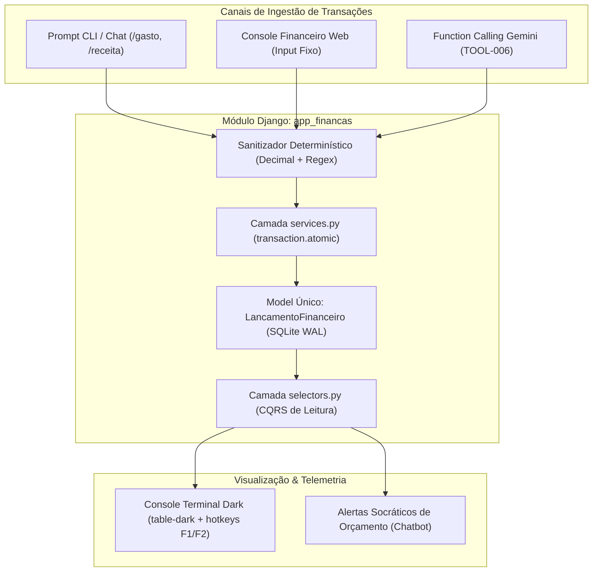

# 🏛️ ADR 006: Arquitetura Modular Local-First para Gestão de Finanças Pessoais (app_financas)

- **Status:** Aprovado & Aguardando Implementação
- **Decisores:** Arquiteto de Software, Especialista em UX/UI, Hacker Pragmático, Advogado do Diabo, Estrategista de Impacto e O Alquimista
- **Data:** 04/11/2026
- **Artefatos de Origem:**
  - [Brainstorm Dialético: BRN-26110401](../brainstorms/26110401_brainstorm_gerenciador_financas_terminal.md)
  - [Síntese Alquímica: ALQ-26110401](../../alquimista_ideias/ouro/26110401_alquimia_93_terminal_financas_soberanas.json)

---

## 1. Contexto & Problema

O ecossistema `projeto_testes` já possui uma infraestrutura madura de IA (chat interativo, RAG vetorial, personas dinâmicas e tool calling determinístico seguro). Surgiu a demanda de expandir a plataforma para incluir recursos de **Gerenciador de Finanças Pessoais**, permitindo ao operador registrar despesas/receitas com extrema agilidade e consultar extratos analíticos.

As abordagens tradicionais de mercado falham por dois extremos:
1. **Overengineering & Insegurança de Nuvem:** Apps comerciais exigem sincronização bancária via Open Finance em nuvens públicas de terceiros, gerando risco severo de vazamento de dados, dependência de APIs externas e quebra de sigilo financeiro.
2. **Fricção de Entrada & Shadow IT:** Formulários web com múltiplos campos forçam o usuário a perder tempo, levando ao abandono do sistema em favor de planilhas locais simples (O Teste da Planilha Implacável do Advogado do Diabo).

---

## 2. Decisão Arquitetural

Decidiu-se pela construção de um módulo **Local-First, Modular e com CQRS Estrito**, totalmente integrado ao monólito Django, fundamentado nos seguintes pilares:

### 2.1. Criação de App Modular Isolado (`app_financas`)
Para manter o desacoplamento de responsabilidades e evitar poluição do `app_chatbot`, cria-se o aplicativo `app_financas`. O app expõe seus serviços para o chatbot através de contratos tipados em `services.py` e `selectors.py`.

### 2.2. Modelo de Dados Enxuto & Índices de Alta Frequência
Para aniquilar overengineering, adota-se uma única entidade relacional central:
- **`LancamentoFinanceiro`**:
  - `usuario`: ForeignKey para `User` com `on_delete=models.CASCADE` e `db_index=True`.
  - `tipo`: CharField de 7 caracteres com choices `RECEITA` e `DESPESA`.
  - `valor`: `DecimalField(max_digits=12, decimal_places=2)` — **proibição estrita de float binário**.
  - `categoria`: CharField de 50 caracteres (indexado) com normalização em minúsculas.
  - `descricao`: CharField de 255 caracteres.
  - `data_competencia`: DateField com valor padrão `timezone.now().date()`.
  - `ativo`: BooleanField (`default=True`, `db_index=True`) para **Soft Delete contábil auditável**.
  - `criado_em` e `atualizado_em`: Timestamps automáticos.
  - **Índice Composto:** `Index(fields=['usuario', 'data_competencia', 'ativo'], name='idx_fin_usr_data_ativo')`.

### 2.3. Padrão CQRS (Services & Selectors Puros)
- **`services.py` (Mutações Atômicas):**
  - `sanitizar_e_validar_valor(raw_val: str | Decimal) -> Decimal`: Valida e normaliza entradas com vírgula ou ponto, garantindo `valor > Decimal("0.00")`.
  - `criar_lancamento(...)`: Envolvido em `transaction.atomic()` com checagem rigorosa de permissões.
  - `excluir_lancamento(lancamento_id, usuario)`: Executa soft delete (`ativo=False`).
- **`selectors.py` (Leituras Sem Efeito Colateral):**
  - `obter_extrato_mensal(usuario, ano, mes) -> QuerySet`: Consulta filtrada com índices compostos.
  - `calcular_balanco_periodo(usuario, ano, mes) -> dict[str, Decimal]`: Agregação pura de total de receitas, total de despesas, saldo líquido e taxa de poupança percentual em uma única query SQL agregada (`aggregate(Sum(...))`).

### 2.4. Ingestão Híbrida: CLI Telegráfico & Function Calling
1. **Comandos Slash no Terminal:** O operador pode registrar transações via `/gasto 45.00 almoco [alimentacao]` ou `/receita 1200.00 consultoria` diretamente no chat ou no console financeiro.
2. **Function Calling (Tools do Gemini):** Exposição das ferramentas catalogadas `TOOL-006_registrar_transacao_financeira` e `TOOL-007_consultar_extrato_financeiro`, permitindo que as personas conversem e analisem os dados com as travas de backend.

### 2.5. Interface em Console Terminal Dark & Ergonomia de Teclado
- Implementação via Function-Based Views (FBV) protegidas por `@login_required` e `@require_http_methods(["GET", "POST"])`.
- Layout em Bootstrap 5 Dark nativo com tipografia monospace, colunas alinhadas à direita para valores monetários, cores funcionais (`#00ff66` para crédito, `#ff5555` para débito) e atalhos rápidos de navegação mensal por teclado (`[F1/F2]`).

---

## 3. Consequências & Trade-offs

### Positivas (+)
- **Latência de Bancada (< 15ms):** Processamento local instantâneo sobre SQLite em WAL mode, eliminando esperas de rede.
- **Soberania Absoluta & Imunidade a Vazamentos:** Zero envio de dados financeiros para nuvens de terceiros ou Open Banking corporativo.
- **Precisão Contábil Rigorosa:** Eliminação completa de bugs de arredondamento de float via `DecimalField` atômico.
- **Auditabilidade Preservada:** Soft Delete permite restaurar transações e mantém o histórico contábil íntegro.
- **Alavancagem de IA Sem Risco de Alucinação:** O LLM só manipula dados através de tools determinísticas com validação no backend.

### Negativas & Mitigações (-)
- **Inserção Manual Inicial:** Sem sincronização automática com contas de banco tradicionais.
  - *Mitigação:* O comando telegráfico de 1 linha (`/gasto ...`) reduz o tempo de lançamento para menos de 2 segundos, batendo o atrito de planilhas manuais.
- **Backup Local Sob Responsabilidade do Usuário:** Como o banco reside localmente no disco SQLite, a perda do arquivo físico afeta os dados.
  - *Mitigação:* Planejamento futuro de ferramenta de exportação/backup automático criptografado em formato JSON/SQLite.

