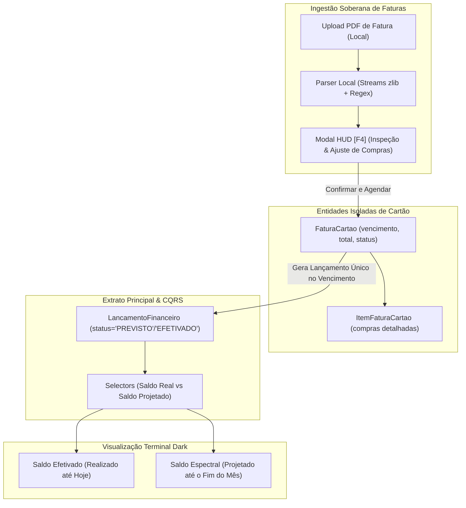

# 🏛️ ADR 007: Ingestão de Faturas de Cartão, Agendamento Contábil e Projeção de Fluxo de Caixa

- **Status:** Aprovado & Aguardando Implementação
- **Decisores:** Arquiteto de Software, Especialista em UX/UI, Hacker Pragmático, Advogado do Diabo, Estrategista de Impacto e O Alquimista
- **Data:** 04/11/2026
- **Artefatos de Origem:**
  - [Brainstorm Dialético: BRN-26110402](../brainstorms/26110402_brainstorm_faturas_cartao_agendamento_multimes.md)
  - [Síntese Alquímica: ALQ-26110402](../../alquimista_ideias/ouro/26110402_alquimia_93_faturas_cartao_fluxo_multimes.json)
  - [ADR Precedente: ADR 006](adr_006_app_financas_local_first_cqrs.md)

---

## 1. Contexto & Problema

Com a entrega bem-sucedida do `app_financas` (Fase 5 do Roadmap), o operador passou a dispor de controle telegráfico sobre receitas e despesas correntes. No entanto, surgiram três requisitos cruciais de gestão financeira:
1. **Controle de Cartão de Crédito sem Dupla Contagem:** Cartões acumulam dezenas de microcompras ao longo do mês. Se cada café e almoço for lançado no extrato geral e a fatura também for debitada na data de vencimento, o saldo contábil sofre dupla contagem (*double-counting*), destruindo a integridade dos relatórios.
2. **Provisões e Agendamentos Futuros:** Despesas fixas (aluguel, internet, fatura a vencer) impactam a solvência do operador antes mesmo de serem debitadas. O sistema atual operava com visão estritamente realizada.
3. **Ingestão Soberana de Documentos (PDF):** A inserção manual de cada compra de cartão gera fadiga operacional extrema. Por outro lado, a integração via Open Finance comercial quebra a privacidade do usuário e vaza hábitos de consumo para nuvens externas de terceiros.

---

## 2. Decisão Arquitetural

Decidiu-se pela expansão do módulo `app_financas` através de uma **Arquitetura Bipartida de Cartão** e **Causalidade Multimês com Saldo Espectral**:



---

### 2.1. Princípio da Bipartição Contábil (Zero Dupla Contagem)
- As compras individuais realizadas no cartão de crédito **NÃO entram no extrato geral** (`LancamentoFinanceiro`).
- Elas são armazenadas na entidade relacional dedicada `ItemFaturaCartao` e visualizadas exclusivamente dentro da **Janela Modal de Fatura** (`[F4]`).
- No extrato geral de movimentações, é gerado **apenas um único lançamento consolidado** (`LancamentoFinanceiro`) com `tipo='DESPESA'`, `valor=total_fatura`, `categoria='cartao_credito'` e `data_competencia=data_vencimento`.

---

### 2.2. Modelagem de Dados Enxuta

#### 1. Extensão de `LancamentoFinanceiro`:
- Adição do campo `status`:
  ```python
  STATUS_EFETIVADO = "EFETIVADO"
  STATUS_PREVISTO = "PREVISTO"
  STATUS_CHOICES = (
      (STATUS_EFETIVADO, "Efetivado (Realizado)"),
      (STATUS_PREVISTO, "Previsto (Agendado)"),
  )
  status = models.CharField(
      max_length=10,
      choices=STATUS_CHOICES,
      default=STATUS_EFETIVADO,
      db_index=True,
      verbose_name="Status Contábil",
  )
  ```
- Lançamentos com `data_competencia > timezone.localdate()` assumem compulsoriamente `status = STATUS_PREVISTO`.

#### 2. Entidade `FaturaCartao`:
- `usuario`: `ForeignKey(User, on_delete=models.CASCADE)`.
- `identificador_cartao`: `CharField(max_length=50)` (ex: `'Nubank Roxo'`, `'Itaú Black'`).
- `mes_referencia`: `PositiveSmallIntegerField()` (1 a 12).
- `ano_referencia`: `PositiveSmallIntegerField()` (ex: 2026).
- `data_vencimento`: `DateField()`.
- `valor_total`: `DecimalField(max_digits=12, decimal_places=2)`.
- `status`: choices `['ABERTA', 'CONSOLIDADA', 'PAGA']`.
- `arquivo_origem`: `CharField(max_length=255, blank=True)` (nome do PDF processado).
- `lancamento_consolidado`: `OneToOneField(LancamentoFinanceiro, null=True, blank=True, on_delete=models.SET_NULL, related_name='fatura_origem')`.
- `UniqueConstraint`: `UniqueConstraint(fields=['usuario', 'identificador_cartao', 'ano_referencia', 'mes_referencia'], name='uniq_fat_usr_cartao_ano_mes')` — **impede compulsoriamente duplo agendamento de fatura**.

#### 3. Entidade `ItemFaturaCartao`:
- `fatura`: `ForeignKey(FaturaCartao, on_delete=models.CASCADE, related_name='itens')`.
- `data_compra`: `DateField()`.
- `descricao`: `CharField(max_length=255)`.
- `categoria`: `CharField(max_length=50, default='outros')`.
- `valor`: `DecimalField(max_digits=12, decimal_places=2)`.
- `parcela_atual`: `PositiveSmallIntegerField(default=1)`.
- `total_parcelas`: `PositiveSmallIntegerField(default=1)`.

---

### 2.3. Camada de Parsing Local de PDF (`services.py`)
- O processamento de PDF ocorre de forma 100% local, aproveitando o analisador de streams com `zlib` e regex já maduro no projeto ou parser Python puro.
- A função `extrair_itens_fatura_pdf(arquivo_bytes) -> dict` identifica padrões de data (`DD/MM`), estabelecimento e valores monetários.
- Antes da persistência, o resultado do parsing é apresentado no Modal HUD para conferência humana, permitindo ajustar data de vencimento e total caso o layout do banco possua particularidades.

---

### 2.4. Camada de Leitura CQRS & O Saldo Espectral (`selectors.py`)
A função `calcular_balanco_periodo` é aprimorada para retornar duas métricas essenciais:
1. **`saldo_efetivado`:**
   $$\text{Saldo Efetivado} = \sum \text{Receitas Efetivadas} - \sum \text{Despesas Efetivadas}$$
   (Considera apenas movimentações com `status='EFETIVADO'`).
2. **`saldo_projetado` (Saldo Espectral):**
   $$\text{Saldo Projetado} = \text{Saldo Efetivado} + \sum \text{Receitas Previstas} - \sum \text{Despesas Previstas}$$
   (Antecipa o débito consolidado da fatura do cartão no vencimento e outras despesas futuras agendadas).

---

## 3. Consequências & Trade-offs

### Positivas (+)
- **Soberania Absoluta:** O usuário audita o extrato completo de compras sem compartilhar senhas bancárias nem trafegar faturas para servidores externos.
- **Zero Poluição Visual e Contábil:** O extrato principal preserva alta densidade e legibilidade, contendo apenas 1 lançamento no dia do vencimento.
- **Previsibilidade Financeira Real (Runway):** O operador sabe exatamente quanto dinheiro sobrará no final do mês antes mesmo de a fatura vencer.
- **Idempotência Garantida no Banco:** A constraint composta impede que erros de duplo clique ou reimportação dupliquem despesas.

### Negativas & Mitigações (-)
- **Variabilidade de Layouts Bancários em PDF:** Bancos alteram periodicamente a diagramação visual de suas faturas.
  - *Mitigação:* A Janela de Conferência no Modal HUD permite ao operador revisar os totais e editar qualquer campo antes de bater o martelo no agendamento.

