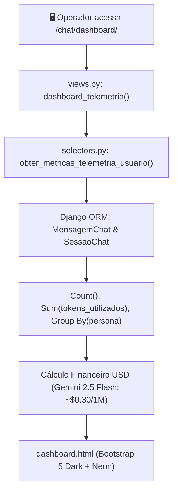

# 📊 Dashboard de Telemetria de Tokens & Custos de IA

Painel executivo no padrão Dark Terminal que consolida métricas de uso de IA, volume de tokens consumidos, distribuição por persona e estimativas de custo financeiro da API do Google Gemini.

---

## 1. 🎯 Objetivos e Valor para o Operador

- **Transparência de Custos:** Visibilidade em tempo real sobre os gastos financeiros estimados com base nos tokens consumidos pelo operador.
- **Rastreabilidade por Persona:** Identificação das personas que mais demandam processamento e tokens no monólito.
- **Auditoria de Sessões:** Listagem detalhada das conversas recentes com contagem individual de mensagens e consumo de tokens.

---

## 2. 🏛️ Arquitetura em Camadas



### Camada `selectors.py`
A função `obter_metricas_telemetria_usuario` agrega os dados sem causar N+1:

```python
def obter_metricas_telemetria_usuario(
    *,
    usuario: Union[AbstractBaseUser, AnonymousUser]
) -> dict[str, Any]:
    """Calcula e consolida as métricas de uso, contagem de tokens e estimativas de custo do operador."""
```

Retorna o seguinte dicionário tipado:
- `total_tokens`: Total de tokens somados nas mensagens do usuário.
- `total_mensagens`: Quantidade de turnos de diálogo.
- `total_sessoes`: Número total de conversas criadas.
- `custo_estimado_usd`: Custo estimado calculado sobre `(total_tokens / 1_000_000) * 0.30`.
- `persona_mais_usada`: Nome da persona com maior volume acumulado de tokens.
- `consumo_por_persona`: Lista de dicionários agrupando persona, especialidade, sessões, mensagens e custo.
- `ultimas_sessoes`: Lista com as 10 conversas mais recentes com tokens e atalhos de abertura e download.

---

## 3. 🎨 Ergonomia Visual e Interface (Terminal Dark)

- **Cards de Métricas:** Destaque numérico com fonte monospace e verde neon (`#00ff66`), amarelo âmbar para custos (`#e3b341`) e ciano para mensagens.
- **Tabelas Estilizadas:** Cabeçalhos em `#06090e` com bordas sutis e linhas hover em alta densidade de informação.
- **Ponto de Acesso:** Botão `📊 TELEMETRIA` fixado no cabeçalho do chat principal e no rodapé de atalhos rápidos.

