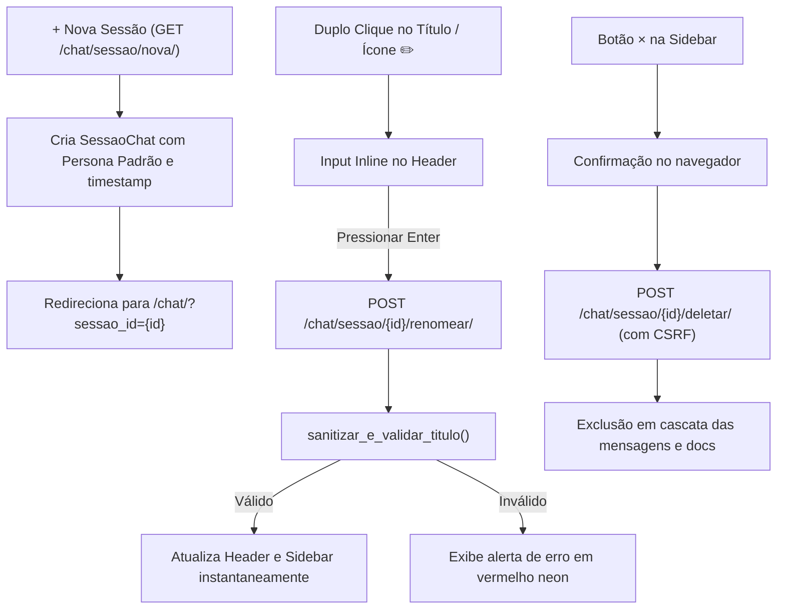

# 🖥️ Módulo Externo: Gerenciamento de Sessões de Chat

Este documento detalha o ciclo de vida de sessões: criação de novas conversas, exclusão segura e renomeação in-place com defesa ativa anti-XSS.

---

## 1. Ciclo de Vida da Sessão

---

## 2. Renomeação In-Place com Blindagem Anti-XSS
- **Experiência de Usuário:**
  - O usuário pode clicar duas vezes no título da sessão no header ou clicar no ícone `✏️`.
  - O título vira um input inline dark/neon. Pressionar `Enter` salva assincronamente via `fetch()`, e `Esc` cancela.
  - Sincroniza em tempo real tanto o título do cabeçalho quanto o item correspondente na Sidebar esquerda sem recarregar a tela (`F5`).
- **Validação Defensiva (`sanitizar_e_validar_titulo`):**
  - **Limite de Tamanho:** Máximo de 80 caracteres e mínimo de 2 caracteres.
  - **Bloqueio Ativo contra Injeções Maliciosas:** Rejeita expressamente tags `<script>`, `<iframe>`, ``, pseudo-protocolos `javascript:`, handlers de evento `onerror=`, `onclick=`, `onload=` e `data:text/html`. Tentativas maliciosas retornam **HTTP 400 Bad Request**.

---

## 3. Exclusão Segura de Sessões (`deletar_sessao`)
- **Proibição de Deleção via GET:**  
  Em conformidade com a RFC 7231 e o guia *Two Scoops of Django*, a rota de exclusão exige **obrigatoriamente o método HTTP POST** com decorator `@require_POST` e token CSRF nativo.
- Tentativas de acesso via `GET` recebem **HTTP 405 Method Not Allowed**, impedindo que web crawlers ou aceleradores de navegador (prefetch) excluam conversas acidentalmente.

