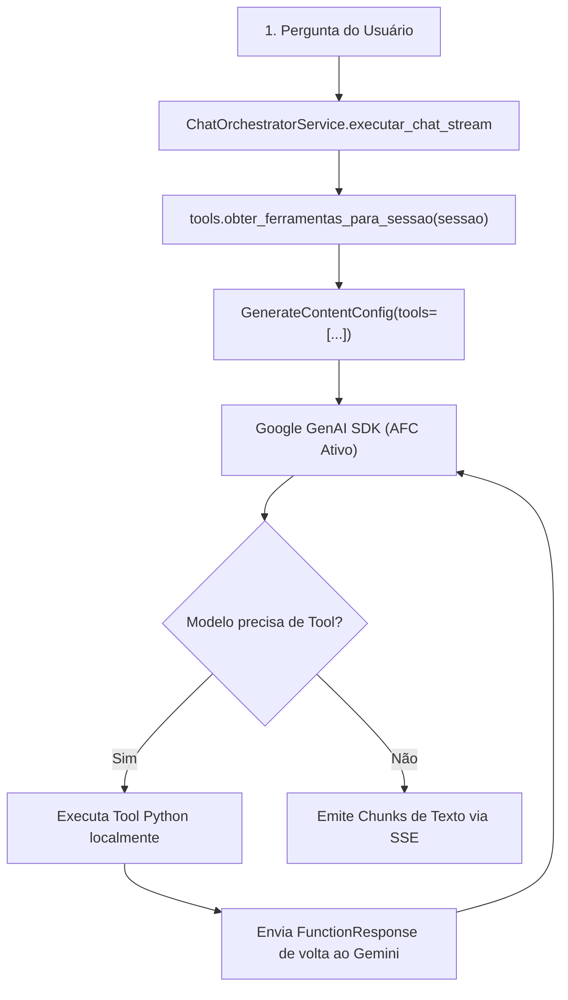

# ⚙️ Módulo Interno: Agentes Multi-Step com Tool Calling (Function Calling)

Este documento especifica a arquitetura e operação do subsistema de ferramentas (`tools.py`) integrado ao modelo Gemini 2.5 Flash via SDK oficial `google-genai` com suporte a **Automatic Function Calling (AFC)**.

---

## 1. 🎯 Objetivo & Princípios de Segurança

O assistente foi capacitado para interagir ativamente com o ecossistema da aplicação, resolvendo cálculos numéricos complexos, consultando data/hora oficial e inspecionando o contexto do operador e da sessão.

### Diretriz Inegociável de Segurança (Anti-RCE & Anti-SQL Injection):
- **Zero `eval()` ou `exec()`:** Expressões matemáticas são avaliadas exclusivamente por um parser customizado de Abstract Syntax Tree (AST), rejeitando funções, variáveis, imports e acessos de atributos.
- **Zero SQL Arbitrário:** Nenhuma ferramenta permite queries SQL livres vindas do modelo. Consultas ao banco são pré-definidas através do Django ORM e encapsuladas com travas multi-tenant anti-IDOR.

---

## 2. 🏛️ Arquitetura do Subsistema

---

## 3. 🛠️ Catálogo de Ferramentas Ativas

| Ferramenta | Descrição & Escopo | Tipo de Execução |
| :--- | :--- | :--- |
| `obter_data_e_hora_oficial` | Retorna a data, horário e dia da semana oficial no fuso `America/Sao_Paulo` e ISO 8601 | Função pura |
| `executar_calculo_matematico` | Avalia expressões matemáticas aritméticas (`+`, `-`, `*`, `/`, `**`, `//`, `%`) via AST segura | Algoritmo numérico seguro |
| `consultar_documentos_sessao` | Lista os documentos e quantidade de chunks indexados via RAG na conversa ativa | Contextual à sessão |
| `obter_informacoes_sessao` | Retorna metadados da sessão (título, persona ativa, turnos de mensagens) | Contextual à sessão |
| `consultar_telemetria_operador` | Exibe o consumo agregado de tokens e custo financeiro estimado do operador em USD | Contextual ao usuário |

---

## 4. ⌨️ Interface do Terminal (Slash Command)

O operador pode auditar e visualizar a qualquer momento as ferramentas ativas no chat através do comando:
- `/tools` (ou `/ferramentas`): Retorna a relação formatada de ferramentas disponíveis para o assistente.

