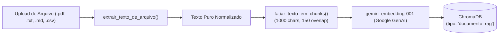

# ⚙️ Módulo Interno: Pipeline de RAG & Chunking de Documentos

Este documento especifica a mecânica interna de ingestão de arquivos, fatiamento em blocos com sobreposição (*chunking*) e recuperação semântica no ChromaDB para suporte ao RAG (Retrieval-Augmented Generation).

---

## 1. Visão Geral do Pipeline



---

## 2. Extração de Conteúdo (`extrair_texto_de_arquivo`)
- **Formatos de Texto Plano (`.txt`, `.md`, `.csv`, `.json`, `.py`, `.html`, `.log`):**
  Decodificação nativa em UTF-8 com fallback para `latin-1`.
- **Arquivos PDF (`.pdf`):**
  Extração de streams descompactadas via `zlib` em pure-python para PDFs legíveis, eliminando dependência obrigatória de bibliotecas C externas no MVP.
- **Limites de Segurança:**
  - Tamanho máximo por arquivo: **5 MB**.
  - Quantidade máxima de chunks indexados por documento no MVP: **50 chunks** (evitando estouro de cotas ou timeouts de requisição).

---

## 3. Algoritmo de Chunking com Overlap (`fatiar_texto_em_chunks`)
- **Tamanho do Bloco (`tamanho_chunk`):** 1.000 caracteres (~250 tokens).
- **Sobreposição (`overlap`):** 150 caracteres.
- **Por que o Overlap é Obrigatório?**
  Sem sobreposição, termos técnicos ou sentenças cortadas no limite exato do caractere perdem o sentido semântico. Os 150 caracteres preservam o contexto de borda entre blocos adjacentes.

---

## 4. Metadados e Expurgo
- **Metadata do Chk no ChromaDB:**
  ```json
  {
    "usuario_id": "1",
    "sessao_id": "uuid-da-sessao",
    "doc_id": "uuid-do-documento",
    "nome_arquivo": "manual.pdf",
    "tipo": "documento_rag"
  }
  ```
- **Expurgo Atômico:**
  Ao excluir o documento via interface, a função `remover_documento_e_vetores` remove o arquivo físico do disco, deleta o registro no SQLite e executa `collection.delete(where={"doc_id": str(documento.id)})` no ChromaDB, garantindo que nenhum resíduo de dados permaneça no índice.

